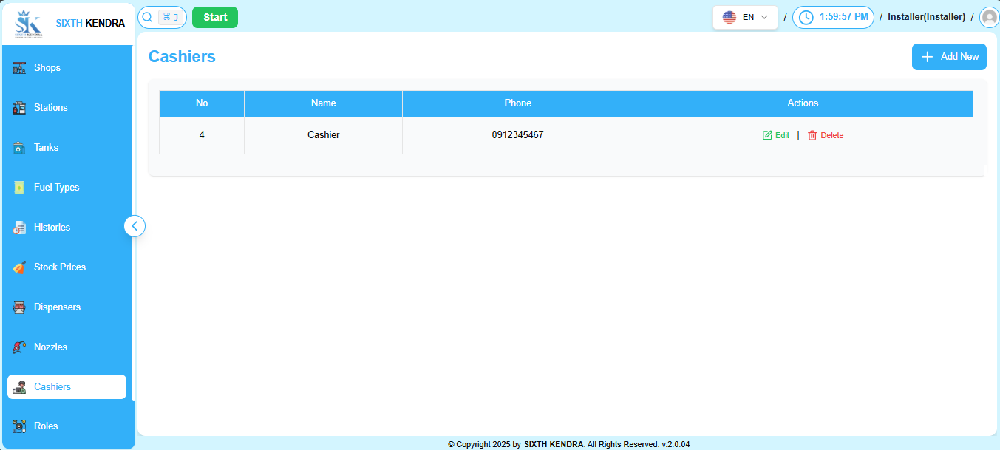
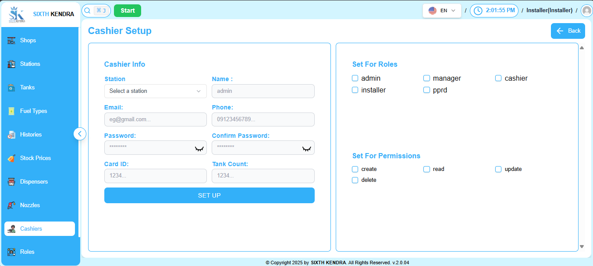

# 6. Cashier Account Setup

## 6.1 Cashier ဖန်တီးခြင်း

1. `Cashiers` Page သို့ သွားပါ။
2. `Add Now` ကို နှိပ်ပါ။

## 6.2 Add Cashier Information

အောက်ပါအချက်အလက်များကို ဖြည့်ပါ။

- `Station` – Cashier တာဝန်ထမ်းဆောင်မည့် Station ကို ရွေးပါ။
- `Name` – Cashier အမည်
- `Email` – Email Address
- `Phone No.` – ဖုန်းနံပါတ်
- `Password` – Login Password
- `RFID Card ID` – Cashier ၏ RFID Card ID
- `Tank Count` – ဆိုင်ရှိ Tank အရေအတွက်
- `Role` – `Cashier` ကို ရွေးပါ။
- `Permission` – လိုအပ်သော Permission များ သတ်မှတ်ပါ။

အချက်အလက်များကို စစ်ဆေးပြီး Cashier Account ကို Setup လုပ်ပါ။

## 6.3 Cashier Account ဖြင့် စမ်းသပ် Login ဝင်ခြင်း

1. Installer Account မှ Logout ထွက်ပါ။
2. ဖန်တီးထားသော Cashier Account ဖြင့် Login ဝင်ပါ။
3. Setup ပြုလုပ်ထားသည့် Station Information များ မှန်ကန်စွာ ပေါ်လာကြောင်း စစ်ဆေးပါ။
4. ဆီမဆွဲမီ Fuel In ထည့်သွင်းရန် လိုအပ်သည်။
