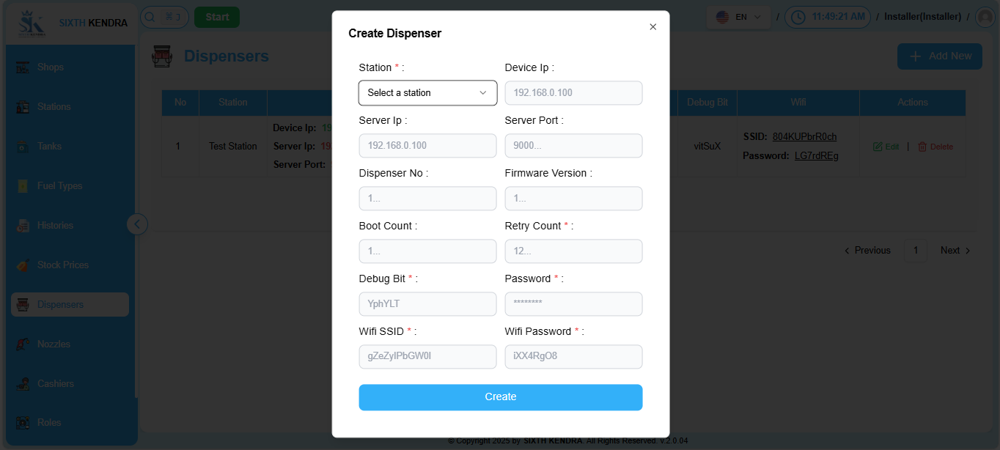
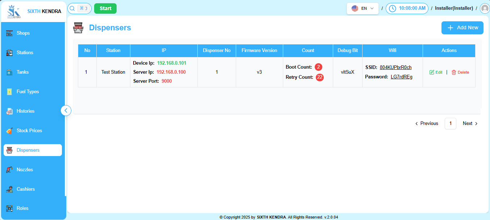
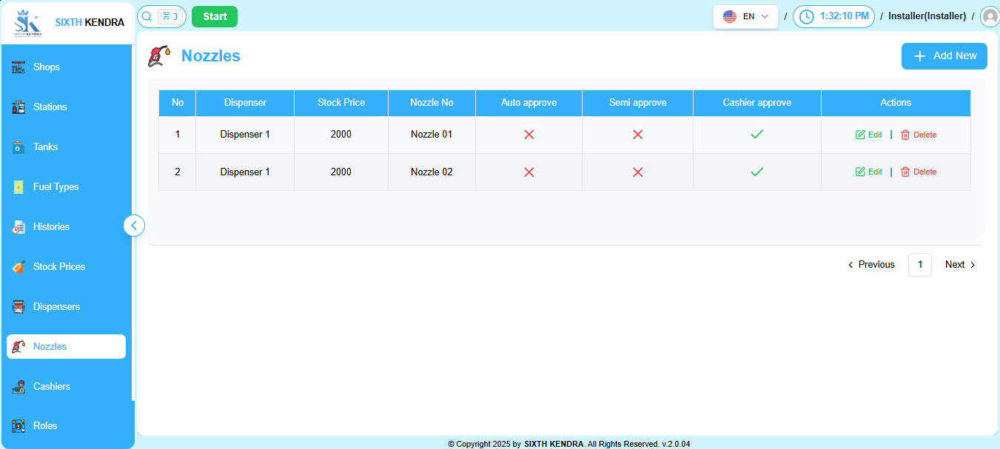
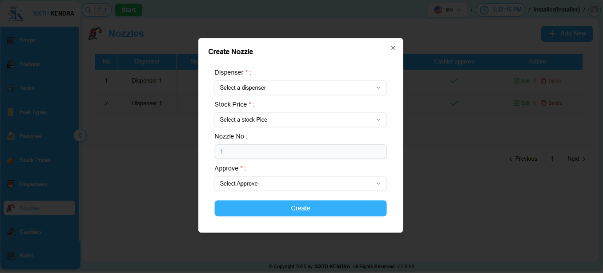

# 5. Dispenser & Nozzle Setup

## 5.1 Dispenser Setup

ဆိုင်ရှိ Dispenser တစ်လုံးချင်းစီကို Register လုပ်ရန် `Dispensers` Page သို့ သွားပြီး `Add Now` ကို နှိပ်ပါ။

### Add Dispenser Information

| Field | ဖြည့်သွင်းရမည့်အချက် |
|---|---|
| Dispenser No. | Dispenser နံပါတ် |
| Station | သက်ဆိုင်ရာ Station |
| Device IP | Dispenser တစ်လုံးစီအတွက် သီးခြား IP Address တစ်ခုစီ ထည့်ပါ။ |
| Server IP | မူရင်းလမ်းညွှန်တွင် `192.168.0.100` ဟု ဖော်ပြထားသည်။ |
| Server Port | မူရင်းလမ်းညွှန်တွင် `9000` ဟု ဖော်ပြထားသည်။ |
| Firmware Version | လက်ရှိအသုံးပြုနေသော Firmware Version |
| Debug Bit | မူရင်းလမ်းညွှန်အရ Future Update များတွင်သာ လိုအပ်မည်ဖြစ်၍ ယခု Setup တွင် သတ်မှတ်နိုင်သည်။ |
| Password | မူရင်းလမ်းညွှန်အရ ယခု Setup တွင် သတ်မှတ်နိုင်သည်။ |
| Wifi SSID | မူရင်းလမ်းညွှန်အရ ယခု Setup တွင် သတ်မှတ်နိုင်သည်။ |
| Wifi Password | မူရင်းလမ်းညွှန်အရ ယခု Setup တွင် သတ်မှတ်နိုင်သည်။ |

အချက်အလက်များဖြည့်ပြီး `Create` ကို နှိပ်ပါ။

> **မှတ်ချက်:** Station နှင့် Dispenser No. များကို မှန်ကန်စွာ ရွေးချယ်/ထည့်သွင်းရန် အရေးကြီးသည်။ Device IP များကို Dispenser တစ်လုံးနှင့်တစ်လုံး မတူညီစေရန် သတ်မှတ်ပါ။

## 5.2 Nozzle Setup

Nozzle တစ်ခုသည် မည်သည့် Tank နှင့် ချိတ်ဆက်ထားသည်ကို ကြိုတင်သိရှိထားရမည်။ ထိုအချက်အလက်မှန်ကန်မှသာ Tank အလိုက် Sale Price ကို သတ်မှတ်နိုင်မည်။

1. `Nozzles` Page သို့ သွားပါ။
2. `Add Now` ကို နှိပ်ပါ။

### Add Nozzle Information

1. `Dispenser No.` ကို ရွေးပါ။
2. `Stock Price` ကို ရွေးချယ်ရာတွင် ထို Nozzle ချိတ်ဆက်ထားသည့် Tank နှင့် ကိုက်ညီသော Stock Price ကို ရွေးပါ။
3. `Nozzle No.` ကို သတ်မှတ်ပါ။
4. `Cashier Approve` ကို ရွေးပါ။
5. အချက်အလက်များကို စစ်ဆေးပြီး Setup ပြုလုပ်ပါ။

> **အရေးကြီး:** Nozzle Number သည် 10 အောက်ဖြစ်ပါက ရှေ့တွင် Zero ထည့်ရမည်။ ဥပမာ `1` မဟုတ်ဘဲ `01` ဟု ထည့်ပါ။
