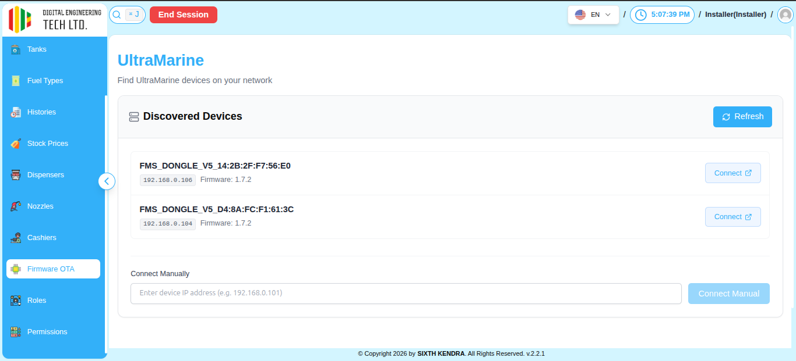
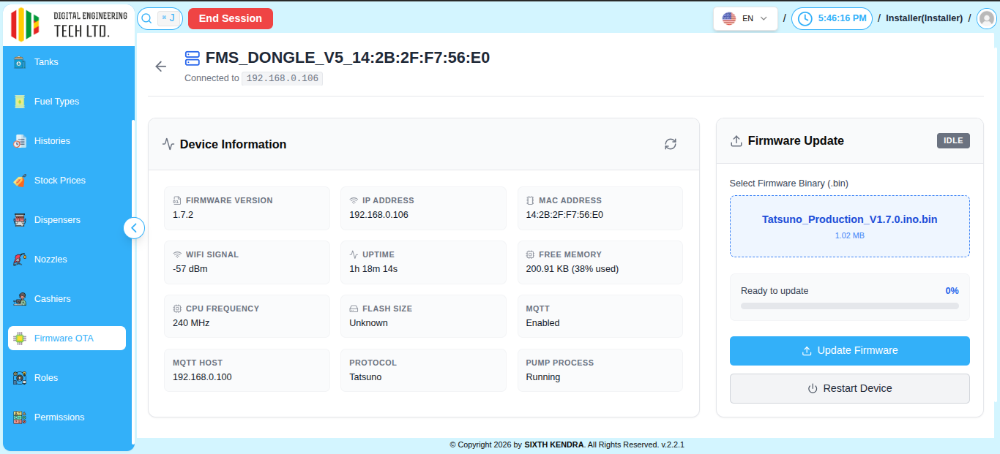

# 8. Firmware OTA Update

Firmware OTA Page တွင် ဆိုင်၌ ချိတ်ဆက်ထားသော Dongle များကို ရှာဖွေနိုင်သည်။ Dongle ၏ IP Address ကို သိရှိပါက `Connect Manually` Input Box တွင် IP Address ထည့်ပြီး `Connect` ကို နှိပ်ကာ တိုက်ရိုက်ချိတ်ဆက်နိုင်သည်။

## 8.1 Update Firmware

1. Update ပြုလုပ်မည့် Firmware `.bin` File ကို ရွေးပါ။
2. `Update Firmware` ကို နှိပ်ပါ။
3. Update အောင်မြင်ပါက Device သည် Auto-Reboot ဖြစ်မည်။
4. Device Online ပြန်ဖြစ်လာသည်အထိ Retry Attempts 30 အထိ ကြိုးစားမည်ဟု မူရင်းလမ်းညွှန်တွင် ဖော်ပြထားသည်။
5. Online ပြန်ဖြစ်ပါက Page Reload ဖြစ်ပြီး `UPTIME` သည် `0s` မှ ပြန်လည် Count လုပ်မည်။

## 8.2 Restart Device

1. Restart ပြုလုပ်ရန် သက်ဆိုင်ရာ Device ကို ရွေးပါ။
2. `Restart` ကို နှိပ်ပါ။
3. Device Online ပြန်ဖြစ်လာသည်အထိ Retry Attempts 30 အထိ စောင့်မည်။
4. Online ပြန်ဖြစ်လာပါက Page Reload ဖြစ်မည်။
