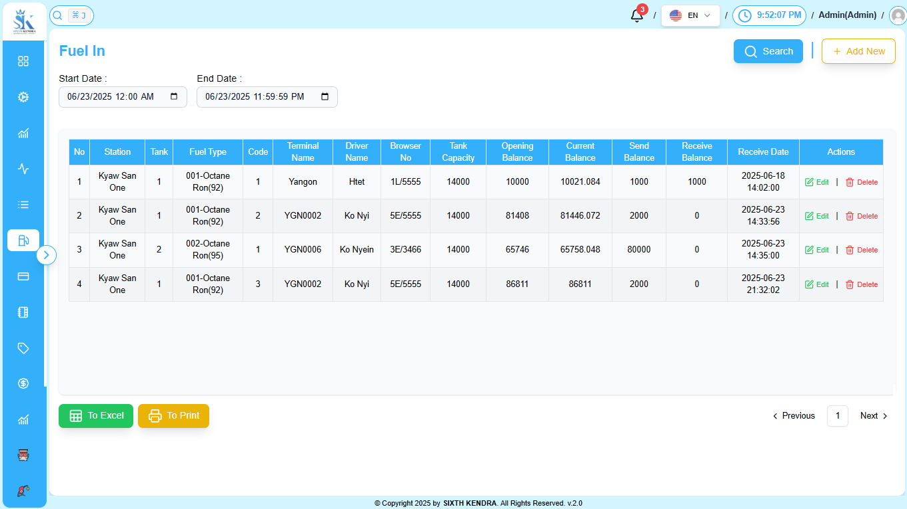
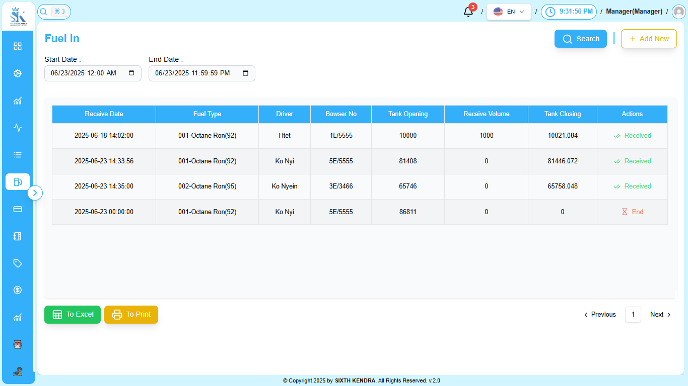
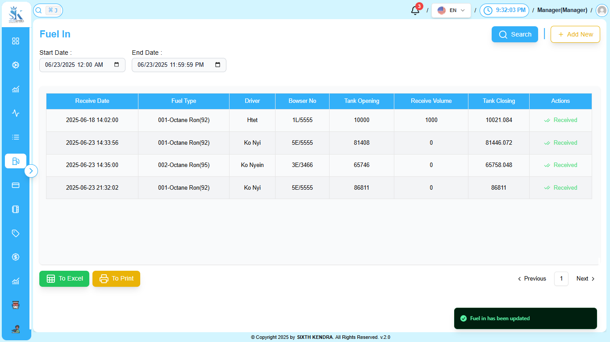

# 7. Fuel In Setup

Fuel In Page တွင် သတ်မှတ်ထားသော ရက်အပိုင်းအခြားအတွင်း Tank တစ်ကန်ချင်းစီ၏ ဆီလက်ကျန်၊ အရောင်းအကြိမ်ရေ၊ အရောင်းလီတာနှင့် အခြားဆီလက်ကျန်ဆိုင်ရာ အချက်အလက်များကို ကြည့်ရှုနိုင်သည်။

ATG တပ်ဆင်ထားခြင်း ရှိ/မရှိအလိုက် Fuel In ထည့်သွင်းပုံ ကွဲပြားသည်။

## 7.1 Non-ATG Users – Add New Fuel In

ATG မတပ်ဆင်ထားသောဆိုင်တွင် Fuel In ကို Manual ဖြင့် ထည့်သွင်းရမည်။

### လုပ်ဆောင်ရန် အဆင့်များ

1. `Fuel In` Page သို့ သွားပါ။
2. ညာဘက်အပေါ်ထောင့်ရှိ `Add New` ကို နှိပ်ပါ။
3. Form တွင် ဖော်ပြထားသော ဆိုင်အမည်၊ Fuel Type၊ Tank No. နှင့် အခြားလိုအပ်သော အချက်အလက်များကို ဖြည့်ပါ။
4. အောက်ပါ Balance များကို မှန်ကန်စွာ ထည့်ပါ။

| Field | ဖြည့်သွင်းရမည့်အချက် |
|---|---|
| Opening Balance | ဆီမထည့်မီ Tank အတွင်းရှိ ဆီပမာဏ |
| Current Balance | ဆီကားမှ ဆီချပြီးနောက် Tank အတွင်းရှိ ဆီပမာဏ |
| Send Balance | လောင်စာဆီခွဲဝေမှုဌာနမှ ခွဲဝေပေးထားသည့် စာရင်းပါ ဆီပမာဏ |
| Receive Balance | ဆီကားမှ ဆီချပြီးနောက် အမှန်တကယ် လက်ခံရရှိသည့် ဆီပမာဏ |

5. အချက်အလက်များ မှန်ကန်ကြောင်း စစ်ဆေးပြီး `Create` ကို နှိပ်ပါ။

### Fuel In Record များကို ရှာဖွေ/ပြင်ဆင်ခြင်း

- `Start Date` နှင့် `End Date` ဖြင့် ကြည့်လိုသည့် Fuel In ရက်အပိုင်းအခြားကို ရှာဖွေနိုင်သည်။
- Permission ရှိသော User သည် Record တစ်ခုချင်းစီရှိ `Edit` ဖြင့် ပြင်ဆင်နိုင်သည်။
- Permission ရှိသော User သည် `Delete` ဖြင့် Record ဖျက်နိုင်သည်။

## 7.2 ATG Users – Add New Fuel In

ATG တပ်ဆင်ထားသောဆိုင်တွင် Form ဖြည့်သွင်းပြီး Fuel In ကို `Start` နှင့် `End` ဖြင့် မှတ်တမ်းတင်ရမည်။

### လုပ်ဆောင်ရန် အဆင့်များ

1. `Fuel In` Page သို့ သွားပါ။
2. ညာဘက်အပေါ်ထောင့်ရှိ `Add New` ကို နှိပ်ပါ။
3. Form တွင် ဖော်ပြထားသော ဆိုင်အမည်၊ Fuel Type၊ Tank No. နှင့် အခြားလိုအပ်သော အချက်အလက်များကို ဖြည့်ပါ။
4. မူရင်းလမ်းညွှန်အရ ATG အသုံးပြုသည့်အခါ Balance အချို့ကို ကိုယ်တိုင်ဖြည့်ရန် မလိုအပ်ဘဲ `Send Balance` တွင်သာ လောင်စာဆီခွဲဝေမှုဌာနမှ ခွဲဝေပေးထားသည့် စာရင်းပါ ဆီပမာဏကို ထည့်ရန် လိုအပ်သည်။
5. အချက်အလက်များ မှန်ကန်ကြောင်း စစ်ဆေးပြီး `Start` ကို နှိပ်ပါ။ ဤအချိန်တွင် Fuel In ၏ Initial Point ကို Record လုပ်မည်။
6. ဆီဖြည့်ခြင်း ပြီးဆုံးသည့်အခါ `End` ကို မဖြစ်မနေ နှိပ်ပါ။

### Start နှင့် End ပြီးနောက်

- `Start` နှိပ်ချိန်တွင် Fuel In စတင်သည့် Initial Point ကို မှတ်တမ်းတင်သည်။
- `End` နှိပ်ပြီးနောက် ATG စက်မှ တိုင်းတာရရှိသော အချက်အလက်များကို အသုံးပြု၍ `Receive Volume` နှင့် `Tank Closing` ကို Auto ဖြည့်သွင်းပေးမည်ဟု မူရင်းလမ်းညွှန်တွင် ဖော်ပြထားသည်။

> **အရေးကြီး:** ATG အသုံးပြုသည့် Fuel In လုပ်ငန်းစဉ်တွင် ဆီဖြည့်ပြီးနောက် `End` ကို မနှိပ်မိပါက လုပ်ငန်းစဉ် ပြီးဆုံးမည်မဟုတ်ပါ။
