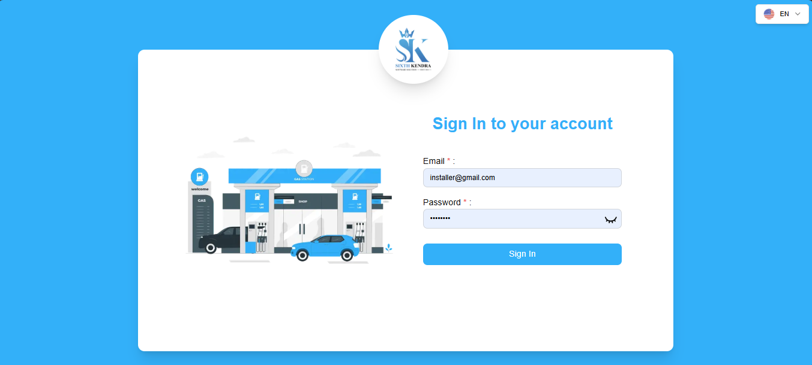
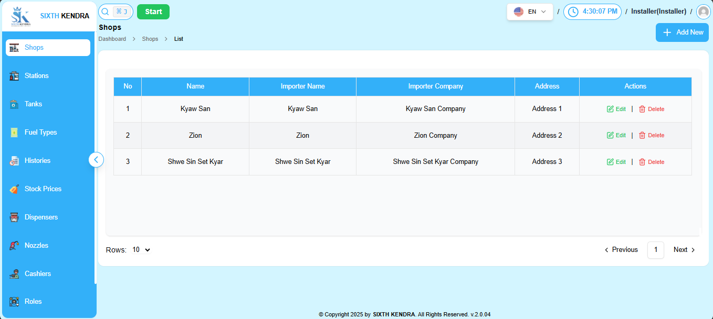
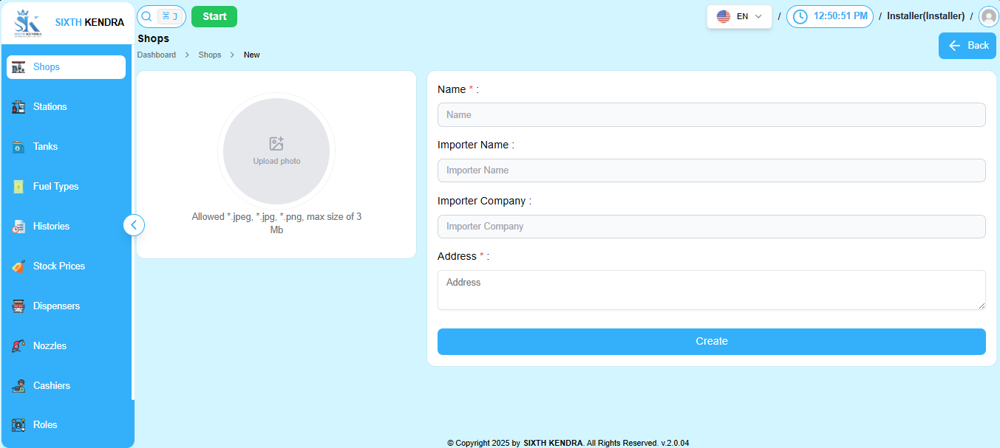
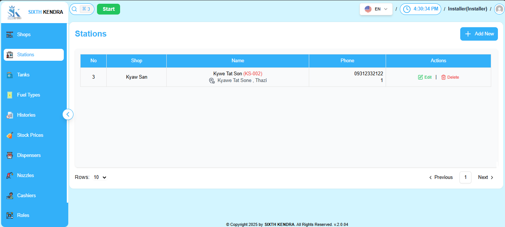
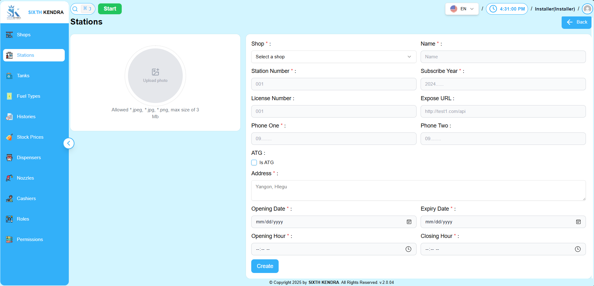

# 2. Shop & Station Setup

## 2.1 Installer Account ဖြင့် Login ဝင်ခြင်း

ဆိုင်ရှိ Dispenser၊ Nozzle၊ Tank စသည်တို့ကို Setup ပြုလုပ်နိုင်ရန် Installer Account ဖြင့် Application သို့ Login ဝင်ပါ။

## 2.2 Shop Setup

1. Login ဝင်ပြီးနောက် `Shops` Page သို့ သွားပါ။
2. `Add Now` ကို နှိပ်ပါ။
3. Shop Information Form ကို ဖြည့်ပါ။

### Add Shop Information

| Field | ဖြည့်သွင်းရမည့်အချက် |
|---|---|
| Name | Setup ပြုလုပ်မည့်ဆိုင်၏ Company အမည် |
| Importer Name | သွင်းကုန်လုပ်ငန်းရှင်အမည် |
| Importer Company | သွင်းကုန်ကုမ္ပဏီအမည် |
| Address | လုပ်ငန်းလိပ်စာ |

အချက်အလက်များဖြည့်ပြီးပါက `Create` ကို နှိပ်ပါ။

> **မှတ်ချက်:** Setup ပြုလုပ်မည့်ဆိုင်သည် `Shops` ထဲတွင် ရှိပြီးသား Company ၏ ဆိုင်ခွဲဖြစ်ပါက Shop အသစ် ထပ်မံ Create လုပ်ရန် မလိုပါ။

## 2.3 Station Setup

1. `Stations` Page သို့ သွားပါ။
2. `Add Now` ကို နှိပ်ပါ။
3. Station Information Form ကို ဖြည့်ပါ။

### Add Station Information

| Field | ဖြည့်သွင်းရန် / သတ်မှတ်ချက် |
|---|---|
| Shop | သက်ဆိုင်ရာ Company ကို ရွေးချယ်ပါ။ |
| Station Name | ဆိုင်အမည် ထည့်ပါ။ ဥပမာ `Kyaw San (Mhaw Bi)` |
| Station Number | Company ၏ ဆိုင်ခွဲဖြစ်ပါက နံပါတ်စဉ်အလိုက် သတ်မှတ်ပါ။ ဥပမာ `KS-002` |
| Subscribe Year | ဆီဆိုင် Software စတင်အသုံးပြုသည့်နှစ် |
| License Number | ဆီဆိုင်၏ လိုင်စင်နံပါတ် |
| Expose URL | မူရင်းလမ်းညွှန်အရ Cloud မှ Price Change ကို Local Station သို့ Sync လုပ်ရန် အသုံးပြုမည့် URL ဖြစ်သည်။ Future Update များအတွက်သာ လိုအပ်သဖြင့် ယခု Setup တွင် ချန်ထားနိုင်သည်။ |
| Phone Number | ဆိုင်၏ ဖုန်းနံပါတ်(များ) |
| ATG | ATG တပ်ဆင်ထားခြင်း ရှိ/မရှိ ရွေးချယ်ပါ။ |
| Address | State/Division ကို အရှေ့တွင်ထားပြီး Comma ခံကာ မြို့နယ်အမည် ထည့်ပါ။ ဥပမာ `Yangon, Mhaw Bi` |
| Opening Date | Cloud Service စတင်သည့်ရက် |
| Expiry Date | Cloud Service သက်တမ်းကုန်ဆုံးမည့်ရက် |
| Opening Hour | ဆိုင်ဖွင့်ချိန် |
| Closing Hour | ဆိုင်ပိတ်ချိန် |

အချက်အလက်များ စစ်ဆေးပြီး `Create` ကို နှိပ်ပါ။
