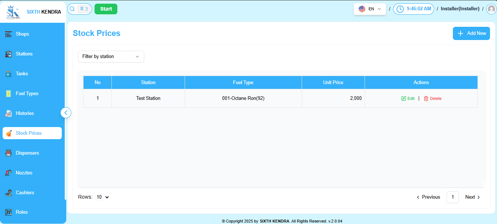
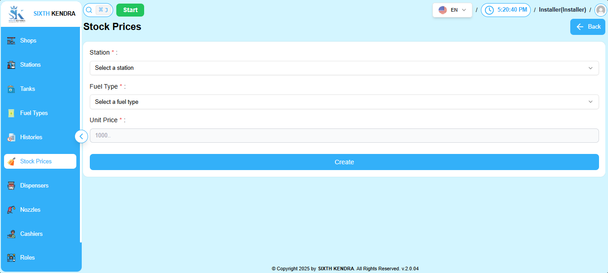

# 4. Stock Price Setup

Tank တစ်ကန်စီတွင် အသုံးပြုမည့် Fuel Type အလိုက် Stock Price နှင့် Unit Price များကို သတ်မှတ်ပါ။

## 4.1 Stock Prices Page

1. `Stock Prices` Page သို့ သွားပါ။
2. `Add Now` ကို နှိပ်ပါ။

## 4.2 Add Stock Price Information

1. `Station` ကို ရွေးပါ။
2. Tank တစ်ကန်ချင်းစီတွင် Setup ချထားသော Fuel Type ကို ရွေးပါ။
3. သက်ဆိုင်ရာ `Unit Price` ကို ထည့်ပါ။
4. အချက်အလက်များကို စစ်ဆေးပြီး သိမ်းဆည်းပါ။

> **အရေးကြီး:** Fuel Type အားလုံးအတွက် Unit Price ကို တစ်ခုချင်းစီ ရွေးချယ်ထည့်သွင်းရမည်။ Fuel Type ရွေးရာတွင် Tank မှားမရွေးမိစေရန် အထူးဂရုပြုပါ။
