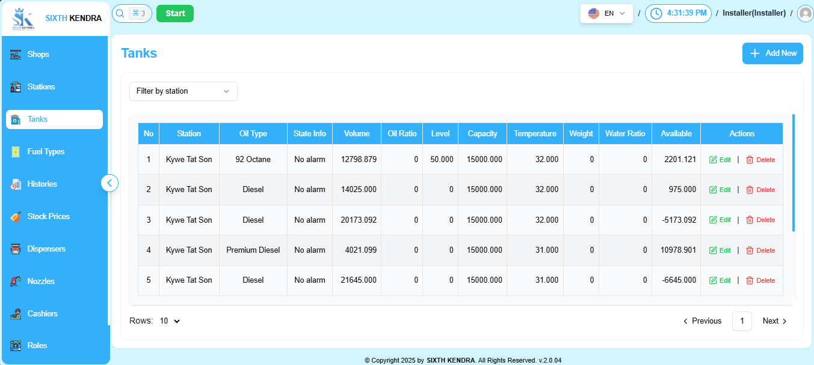
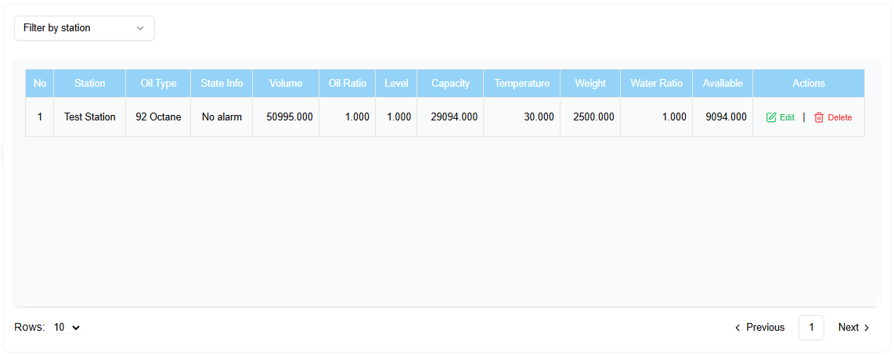
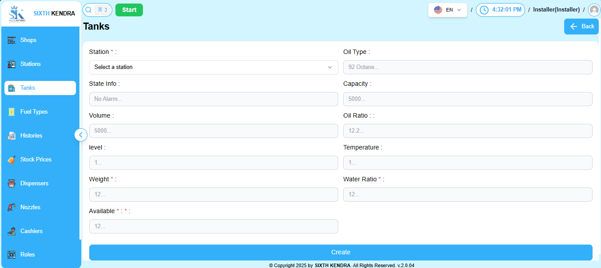
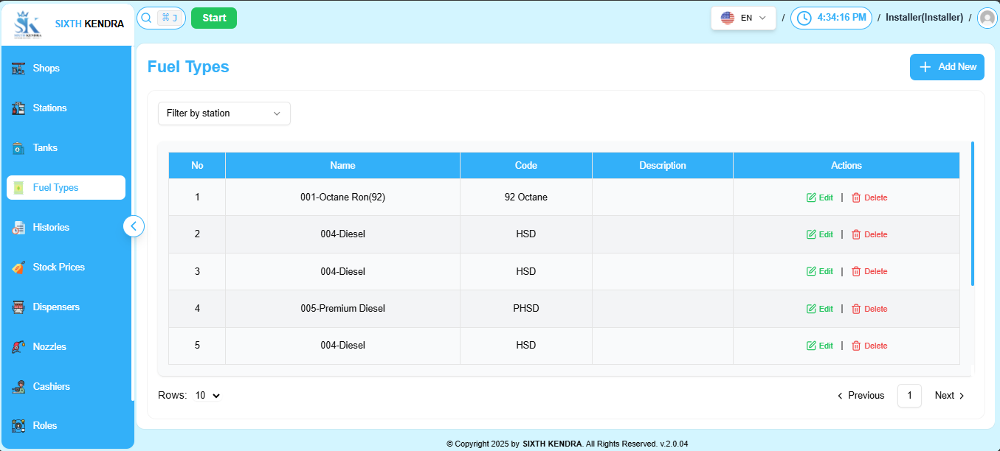
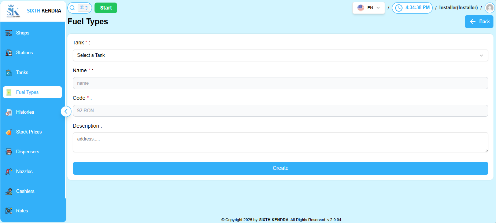
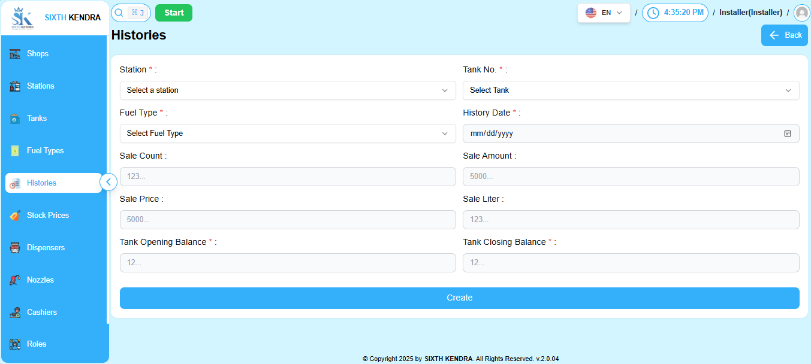
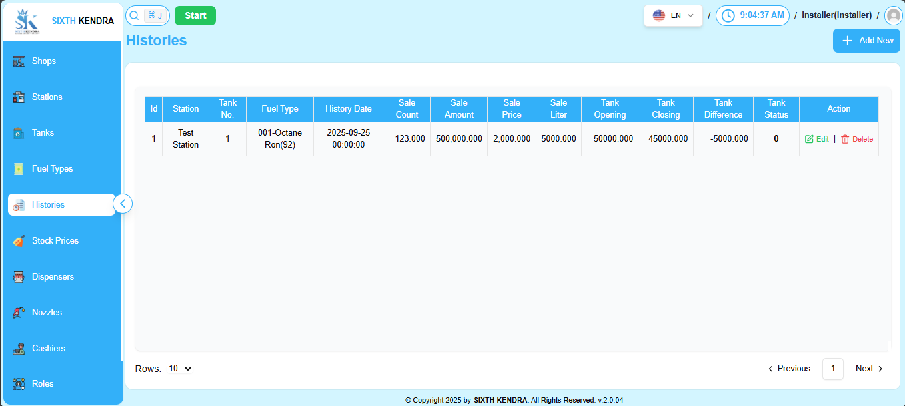

# 3. Tank, Fuel Type & History Setup

## 3.1 Tank Setup

1. `Tanks` Page သို့ သွားပါ။
2. `Add Now` ကို နှိပ်ပါ။
3. Tank Information ကို ဖြည့်ပါ။

### Add Tank Information

| Field | ဖြည့်သွင်းရမည့်အချက် |
|---|---|
| Station | သက်ဆိုင်ရာ Station ကို ရွေးပါ။ |
| Fuel Type | Tank အတွင်းရှိ ဆီအမျိုးအစားကို သတ်မှတ်ပါ။ ဥပမာ 92 Octane, 95 Octane, Diesel, Premium Diesel |
| State Info | Tank တွင် Alarm ရှိ/မရှိ ထည့်ပါ။ |
| Capacity | Tank Capacity ကို Liter ဖြင့် ထည့်ပါ။ |
| Volume | Tank အတွင်း လက်ရှိကျန်ရှိသော ဆီပမာဏကို Liter ဖြင့် ထည့်ပါ။ |

**Unit Conversion**

မူရင်းလမ်းညွှန်တွင် `1 Gallon = 4.546 Liters` ဟု သတ်မှတ်ထားသည်။ Gallon ဖြင့် ရရှိထားသော Capacity သို့မဟုတ် Volume ကို Liter သို့ ပြောင်းပြီးမှ ထည့်ပါ။

### ATG Tank Information

- ATG တပ်ဆင်ထားပါက ATG စက်မှ ရရှိသော `Oil Ratio`, `Level`, `Temperature`, `Weight`, `Water Ratio` တို့ကို ဖြည့်ပါ။
- ATG မရှိပါက မူရင်းလမ်းညွှန်အရ `Oil Ratio = 1`, `Level = 1`, `Water Ratio = 1`, `Temperature = 30`, `Weight = 2500` ဟု ထည့်ပါ။

Tank Information စစ်ဆေးပြီး `Create` ကို နှိပ်ပါ။

## 3.2 Fuel Types Setup

မူရင်းလမ်းညွှန်တွင် Fuel Types Setup အတွက် `Tanks` Page ရှိ `Add Now` ကို အသုံးပြုရန် ဖော်ပြထားသည်။ Fuel Type တစ်ခုချင်းစီကို သက်ဆိုင်ရာ Tank နှင့် ကိုက်ညီအောင် သတ်မှတ်ပါ။

### Fuel Name နှင့် Fuel Code

| Fuel Name | Fuel Code |
|---|---|
| 001-Octane Ron(92) | 92 Octane |
| 002-Octane Ron(95) | 95 Octane |
| 004-Diesel | HSD |
| 005-Premium Diesel | PHSD |

## 3.3 Histories Setup

Histories တွင် Tank တစ်ကန်ချင်းစီ၏ Opening၊ Closing၊ Fuel In၊ အရောင်းလီတာ၊ အရောင်းပမာဏနှင့် Sale Count တို့ကို ထည့်သွင်းမှတ်တမ်းတင်သည်။

1. Histories Page သို့ သွားပါ။
2. `Add Now` ကို နှိပ်ပါ။

### Add Histories Information

| Field | ဖြည့်သွင်းရမည့်အချက် |
|---|---|
| Station | သက်ဆိုင်ရာ Station ကို ရွေးပါ။ |
| Tank No. | Tank နံပါတ်ကို ရွေးပါ။ ရွေးချယ်ပြီးပါက Fuel Type သည် AutoSelect ဖြစ်မည်။ |
| History Date | Tank Opening နှင့် Closing အတွက် သက်ဆိုင်ရာရက်ကို ရွေးပါ။ |
| Sale Count | Tank မှ ရောင်းချခဲ့သည့် အရောင်းအကြိမ်ရေ |
| Sale Amount | စုစုပေါင်း အရောင်းပမာဏ |
| Sale Price | ရောင်းချခဲ့သည့် Fuel Type ၏ ဈေးနှုန်း |
| Sale Liter | စုစုပေါင်း ရောင်းချခဲ့သည့် လီတာ |
| Tank Opening | စတင်ချိန် Tank လက်ကျန် |
| Tank Closing | ပိတ်ချိန် Tank လက်ကျန် |

> **အရေးကြီး:** မူရင်း Installer Guide အရ History ကို Station Setup ပြုလုပ်ချိန်တွင်သာ ထည့်သွင်းရန်ဖြစ်ပြီး Setup ပြီးနောက် ထပ်ထည့်ရန် မလိုတော့ပါ။ ထို့ကြောင့် မထည့်မီ အချက်အလက်များကို ဆိုင်နှင့် ပြန်လည်အတည်ပြုပါ။
