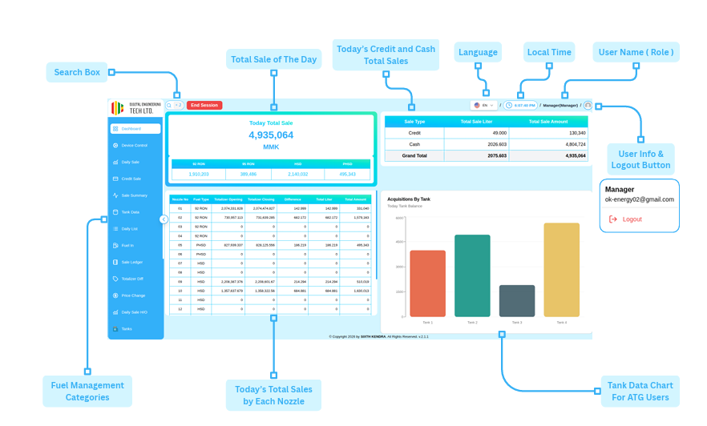
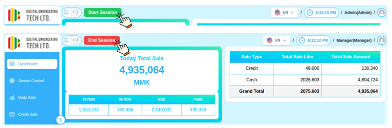

# Application Website

## Contents

- [1. Login Page](#1-login-page)
- [2. Manager Dashboard Overview](#2-manager-dashboard-overview)
- [3. Start & End Buttons](#3-start-end-buttons)
- [4. IMPORTANT THINGS TO FOLLOW](#4-important-things-to-follow)

## 1. Login Page

ပထမဦးစွာ Data အချက်အလက်များ လုံခြုံစိတ်ချမှုရှိစေရန် သတ်မှတ်ထားသော **Username** နှင့် **Password** ကို မှန်ကန်စွာ ဖြည့်သွင်းမှသာ Software ကို ဆက်လက်အသုံးပြုနိုင်မည်ဖြစ်သည်။

---

## 2. Manager Dashboard Overview

Manager Dashboard တွင် အောက်ပါအချက်အလက်များကို Overall ကြည့်ရှုနိုင်မည်ဖြစ်သည်။

- တစ်နေ့တာ ရောင်းအား စုစုပေါင်း (Today Total Sale)

- ဆီအမျိုးအစားတစ်ခုချင်းစီ၏ ဈေးနှုန်းနှင့် ရောင်းအားစုစုပေါင်း

- Tank တစ်ခုချင်းစီ၏ ဆီလက်ကျန်များ (ATG ရှိသောဆိုင်များသာ)

---

## 3. Start & End Buttons

Start & End Buttons သည် ဆီဆိုင်၏ တစ်နေ့တာ Tank Opening, Tank Closing, အရောင်းလီတာ၊ ဆီကန်တစ်ကန်ချင်းစီအလိုက် ရောင်းချထားသော Voucher အရေအတွက်နှင့် Fuel In အချက်အလက်များကို နေ့စဉ် မှတ်တမ်းတင်ပေးနိုင်သည့် လုပ်ဆောင်ချက်ဖြစ်သည်။

- မနက်ခင်း ဆီစတင်ရောင်းချမည့်အချိန်တွင် **Start Button** ကို နှိပ်ပေးရမည်။

- တစ်နေ့တာ ဆီရောင်းချမှု ပြီးဆုံး၍ ဆီဆိုင်ပိတ်သိမ်းချိန်တွင် **End Button** ကို နှိပ်ပေးရမည်။

- End Button ကို နှိပ်ခြင်းဖြင့် တစ်နေ့တာအတွက် Tank နှင့် Sales အချက်အလက်များကို သိမ်းဆည်းနိုင်မည်ဖြစ်သည်။

---

## 4. IMPORTANT THINGS TO FOLLOW

**ဆီဆိုင်မှ လိုက်နာရမည့်အချက်များမှာ -**

1. မနက်ခင်း ဆီမစတင်ရောင်းချမီ Navbar ရှိ **Start Button** ကို မဖြစ်မနေ နှိပ်ပေးရန်နှင့် ဆီသိမ်းချိန်တွင် **End Button** ကို နေ့စဉ် မပျက်မကွက် နှိပ်ပေးရန်။

2. End Button မနှိပ်မီ **Sale Ledger** Page ရှိ **Add Today Tank Balance Table** တွင် ဆီကန်တစ်ကန်ချင်းစီ၏ ဆီလက်ကျန်ပမာဏများကို ထည့်သွင်းထားခြင်း ရှိ/မရှိ စစ်ဆေးရန်။

3. **Fuel In** ဝင်သည့်အချိန်တွင် Software ထဲသို့ မဖြစ်မနေ ထည့်သွင်းပေးရန်။

4. ဆီဝင်သည့်နေ့တွင် Software ထဲသို့ ထည့်သွင်းရန် ကျန်ရှိပါက Company သို့ ချက်ချင်းအကြောင်းကြားရန်။

5. **Car No. တစ်ခုတည်းကို Vehicle Type အမျိုးမျိုး သတ်မှတ်ခြင်း မပြုရန်။**

6. **Car No. တစ်ခုတည်းကို Fuel Type အမျိုးမျိုးဖြင့် ရောင်းချခြင်း မပြုရန်။**

---
