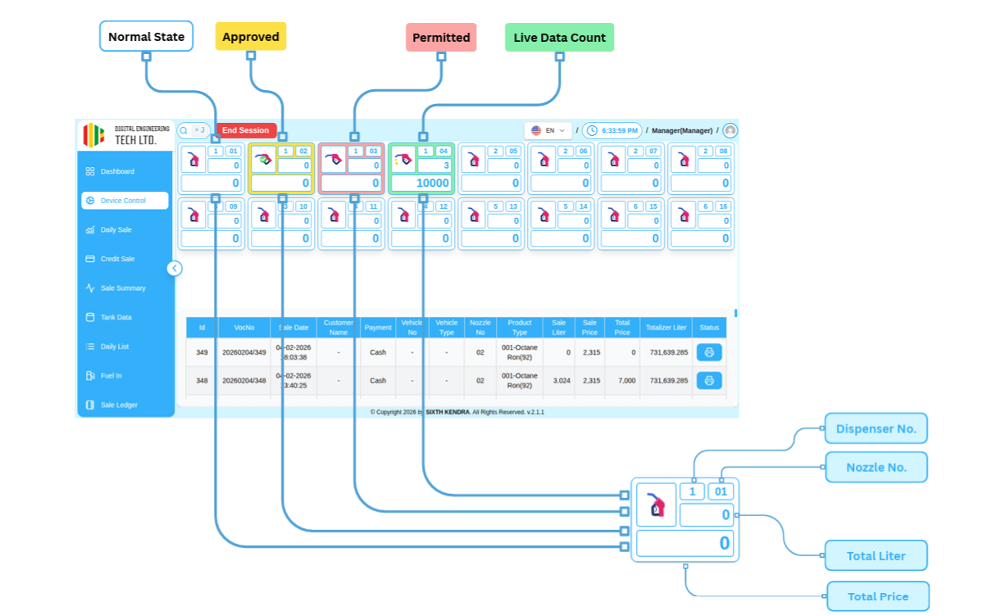
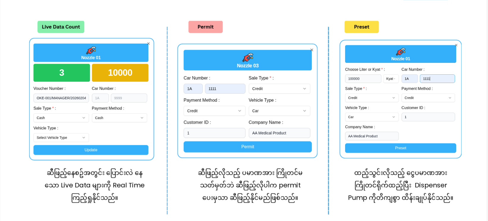
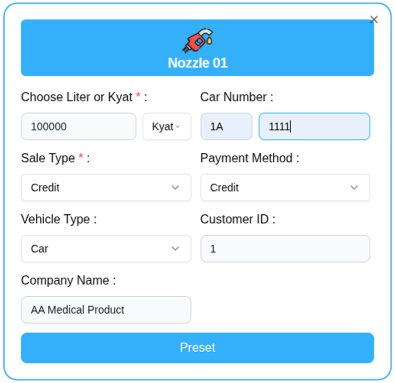
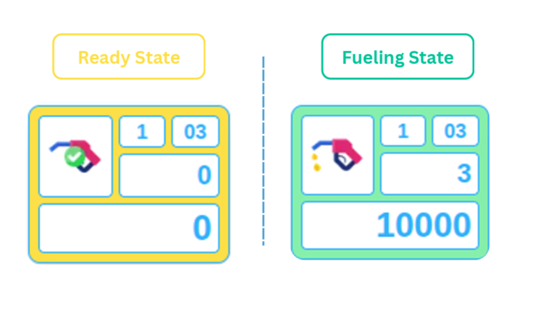
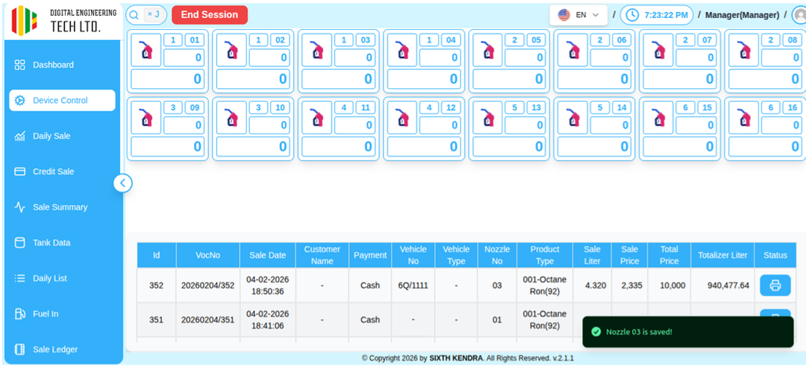
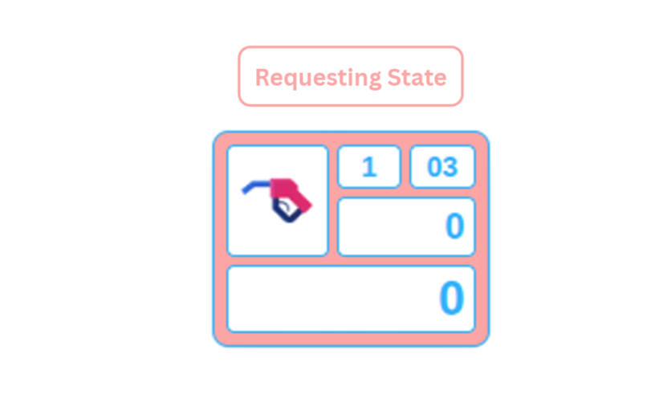
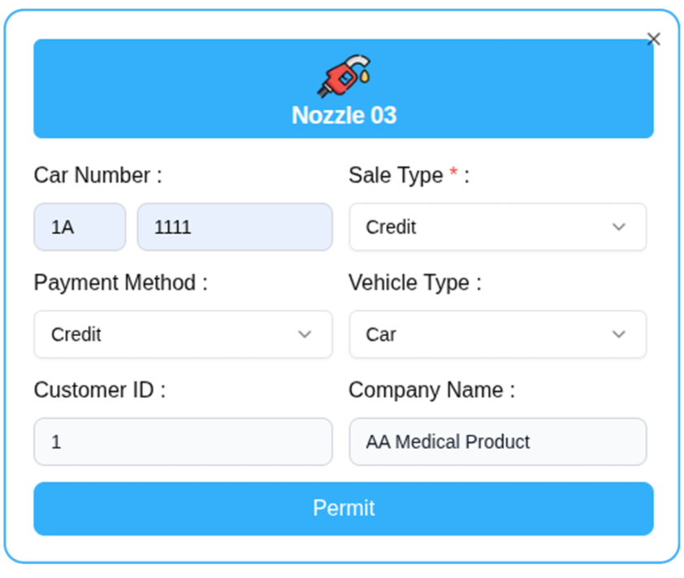
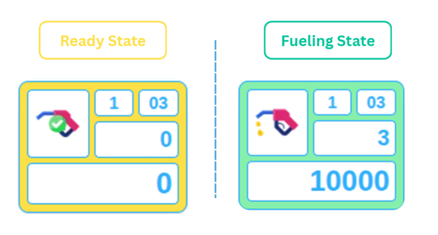
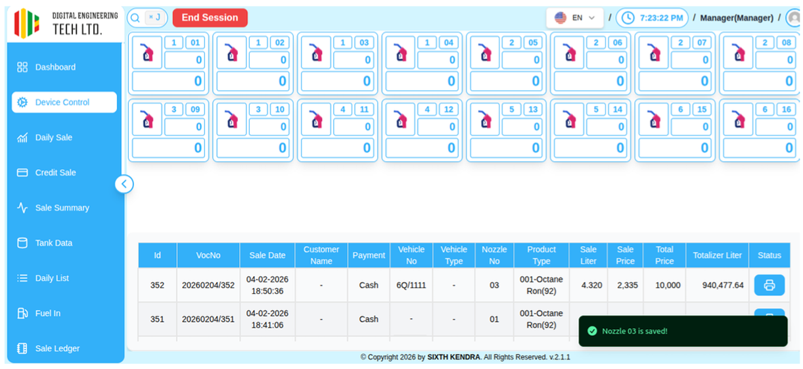
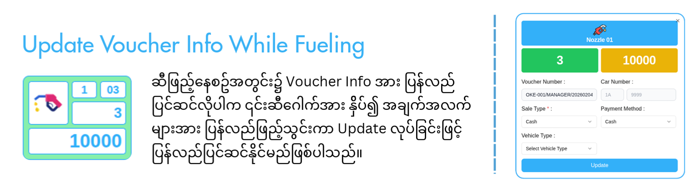

# Device Control

## Contents

- [5. Device Control Overview](#5-device-control-overview)
  - [Main Features](#main-features)
- [6. Types of Fueling in Device Control](#6-types-of-fueling-in-device-control)
- [6.1. Preset Type Fueling Steps](#61-preset-type-fueling-steps)
  - [Preset Ready State](#preset-ready-state)
  - [Complete Fueling](#complete-fueling)
- [6.2. Permit Type Fueling Steps](#62-permit-type-fueling-steps)
  - [Step 1: Nozzle Request](#step-1-nozzle-request)
  - [Step 2: Grant Permit](#step-2-grant-permit)
  - [Step 3: Ready State](#step-3-ready-state)
  - [Step 4: Complete Fueling](#step-4-complete-fueling)
  - [Update Voucher Information](#update-voucher-information)

## 5. Device Control Overview

Station အတွင်းရှိ Nozzle များအားလုံးကို Overall ကြည့်ရှုနိုင်ပြီး **Preset** နှင့် **Permit** စသည့် လုပ်ဆောင်ချက်များကို ထိန်းချုပ်နိုင်မည်ဖြစ်သည်။

### Main Features

---

## 6. Types of Fueling in Device Control

Device Control Page တွင် Nozzle တစ်ခုချင်းစီ၏ အချက်အလက်များကို Real-Time ကြည့်ရှုနိုင်မည်ဖြစ်ပြီး ဆီဖြည့်သည့်နည်းလမ်း (၂) မျိုးရှိပါသည်။

- **Preset:** Customer မှ ဆီဖြည့်လိုသည့် ငွေပမာဏကို ရိုက်ထည့်၍ ဆီဖြည့်ခြင်း။

- **Permit:** Customer မှ ထည့်လိုသည့် ဆီပမာဏကို ကြိုတင်သတ်မှတ်ခြင်းမရှိဘဲ လိုအပ်သည့်ပမာဏရောက်သည်အထိ ဆီဖြည့်ခြင်း။

---

## 6.1. Preset Type Fueling Steps

**Preset ဖြင့် ဆီဖြည့်မည်ဆိုပါက အောက်ပါအဆင့်များအတိုင်း ဆောင်ရွက်ရမည်။**

1. မိမိဆီဖြည့်လိုသည့် Nozzle ကို Device Control Page မှ ရွေးချယ်နှိပ်ပါ။

2. Kyat သို့မဟုတ် Liter ဖြင့် ဆီဖြည့်နိုင်ပြီး ထည့်သွင်းလိုသည့် ပမာဏကို Input Box တွင် ဖြည့်သွင်းပါ။

3. Liter ဖြင့် ဆီဖြည့်မည်ဆိုပါက ပမာဏကို ဒဿမ ၃ နေရာအထိ ထည့်သွင်းပေးရမည်။

   ဥပမာ - ဆီ 12 Liter ဖြည့်လိုပါက Input Box တွင် `12.000` ဟု ထည့်သွင်းပေးရမည်ဖြစ်သည်။

4. ဆီလာဖြည့်သည့် Customer သည် Credit Customer ဖြစ်ပါက **Car No.** နေရာတွင် Customer ၏ Car No. ကို ရိုက်ထည့်ရုံဖြင့် Sale Type၊ Payment Method စသည့် Customer Information များကို Auto-Select ပြုလုပ်ပေးမည်ဖြစ်သည်။

### Preset Ready State

**Preset** ခလုတ်ကို နှိပ်လိုက်ပါက Nozzle သည် ဆီဖြည့်ရန် အသင့်ဖြစ်နေသော **Ready State** သို့ ရောက်ရှိသွားမည်ဖြစ်သည်။

ထို့နောက် Nozzle ကို အသုံးပြု၍ ကြိုတင်သတ်မှတ်ထားသည့် ပမာဏအတိုင်း ဆီဖြည့်နိုင်မည်ဖြစ်သည်။

### Complete Fueling

ဆီဖြည့်ပြီးနောက် Nozzle ကို ပြန်လည်ချိတ်ဆက်လိုက်ပါက ရောင်းချထားသည့် Voucher ကို အောက်ပါ Table တွင် အလိုအလျောက် Create ပြုလုပ်ပေးမည်ဖြစ်သည်။

ဤအဆင့်တွင် Preset ဖြင့် ဆီဖြည့်ခြင်း လုပ်ငန်းစဉ် ပြီးဆုံးပြီဖြစ်သည်။

---

## 6.2. Permit Type Fueling Steps

### Step 1: Nozzle Request

**Permit ဖြင့် ဆီဖြည့်မည်ဆိုပါက အောက်ပါအဆင့်များအတိုင်း ဆောင်ရွက်ရမည်။**

ဆီဖြည့်လိုသည့် Nozzle ကို စတင်အသုံးပြုသည့်အခါ Device Control Page တွင် သက်ဆိုင်ရာ Nozzle သည် ပုံတွင်ပြထားသည့်အတိုင်း အနီရောင်ဖြင့် ပေါ်လာမည်ဖြစ်သည်။

### Step 2: Grant Permit

အဆိုပါ Nozzle ကို နှိပ်လိုက်ပါက Permit တောင်းဆိုရန် Form ပေါ်လာမည်ဖြစ်သည်။

လိုအပ်သော အချက်အလက်များကို ဖြည့်သွင်းပြီး **Permit** ခလုတ်ကို နှိပ်ခြင်းဖြင့် ဆီဖြည့်ခွင့် Permission ပေးနိုင်မည်ဖြစ်သည်။

### Step 3: Ready State

Permit ပေးလိုက်သည်နှင့် Nozzle သည် ဆီဖြည့်ရန် အသင့်ဖြစ်နေသော **Ready State** သို့ ရောက်ရှိသွားမည်ဖြစ်သည်။

ထို့နောက် Customer လိုအပ်သည့် ပမာဏရောက်သည်အထိ ဆီဖြည့်နိုင်မည်ဖြစ်သည်။

### Step 4: Complete Fueling

ဆီဖြည့်ပြီးနောက် Nozzle ကို ပြန်လည်ချိတ်ဆက်လိုက်ပါက ရောင်းချထားသည့် Voucher ကို အောက်ပါ Table တွင် အလိုအလျောက် Create ပြုလုပ်ပေးမည်ဖြစ်သည်။

ဤအဆင့်တွင် Permit ဖြင့် ဆီဖြည့်ခြင်း လုပ်ငန်းစဉ် ပြီးဆုံးပြီဖြစ်သည်။

### Update Voucher Information

ဆီဖြည့်ပြီးနောက် Voucher Information ကို ပြန်လည်ပြင်ဆင်လိုပါက သက်ဆိုင်ရာ Voucher ကို ရွေးချယ်ပြီး လိုအပ်သော အချက်အလက်များကို ပြန်လည်ဖြည့်သွင်းကာ Update ပြုလုပ်နိုင်မည်ဖြစ်သည်။

---
