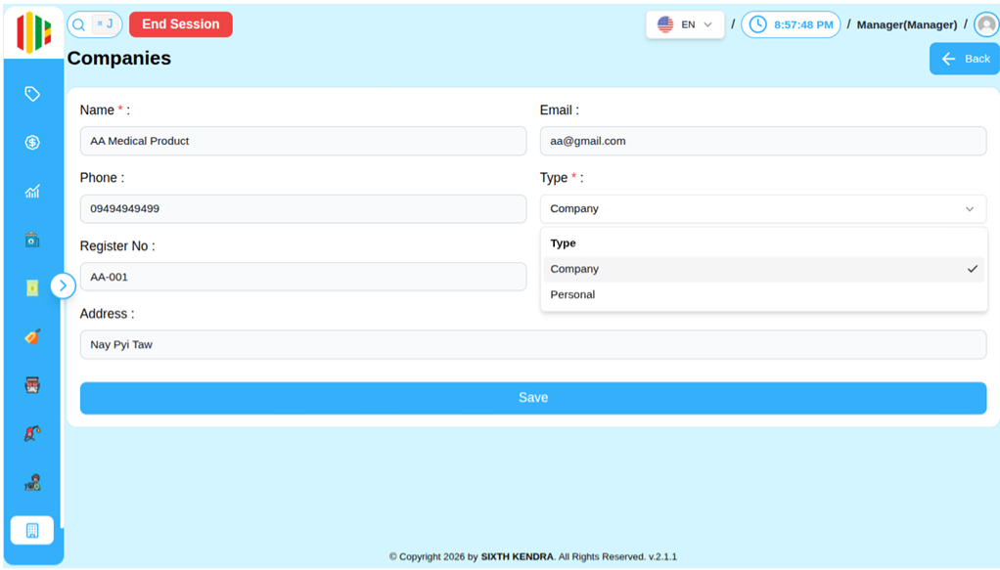
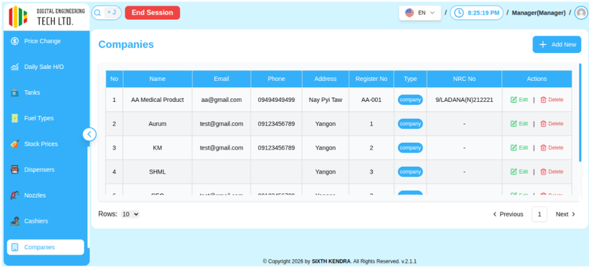
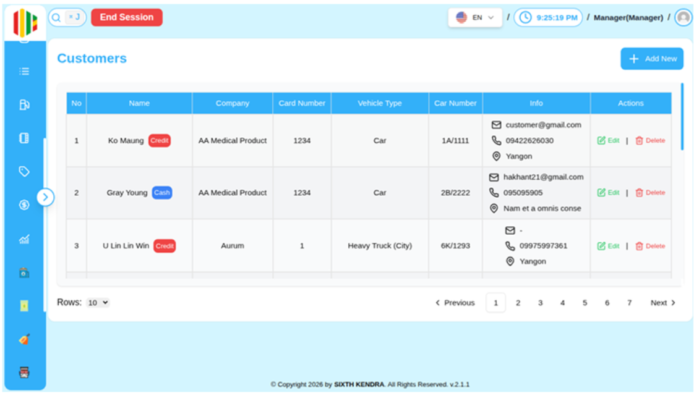
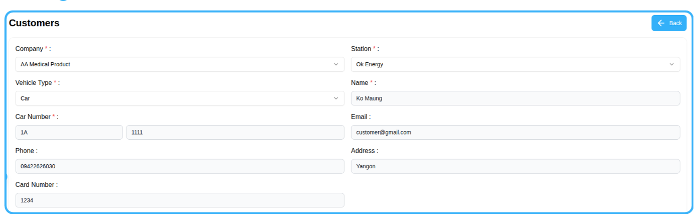
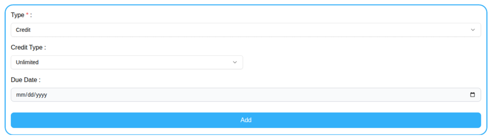
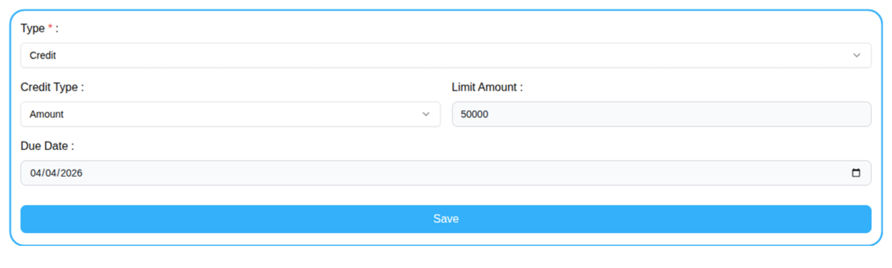
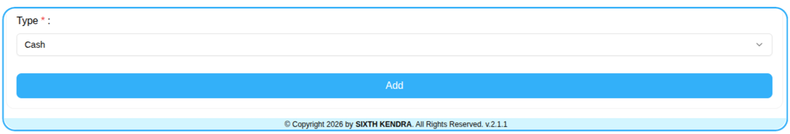
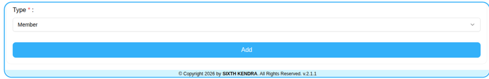

# Master Data Management

## Contents

- [Companies](#companies)
  - [Customers](#customers)
  - [Adding a Customer](#adding-a-customer)
    - [Credit Customer ( Unlimited )](#credit-customer-unlimited-)
    - [Credit Customer ( Limited )](#credit-customer-limited-)
    - [Normal Customer ( Cash )](#normal-customer-cash-)
    - [Member Card Customer ( Member )](#member-card-customer-member-)

## Companies

* Customer များ၏ သက်ဆိုင်ရာ Company များအား ထည့်သွင်းနိုင်ရန်အတွက် လိုအပ်သည့် Info များအား ဖြည့်၍ Type ၌ “Company” သော်လည်းကောင်း၊ Personal Company ဖြစ်ပါက “Personal” အား လည်းကောင်း ရွေးချယ်ကာ Create လုပ်နိုင်ပါသည်။

---

### Customers

* Customer များအား “Credit”, “Member”, “Cash” ဟူသော Type များဖြင့်ခွဲခြားထားပြီး အကြွေးစနစ်ဖြင့်ဝယ်ယူမည့် “Credit” Customer, “Member” Card System ဖြင့် အသုံးပြုမည့် Customer, ပုံမှန်ဝယ်ယူနေကျ Customer ဟူ၍ သတ်မှတ်ထားပါသည်။

### Adding a Customer

* Customer အား Create လုပ်ရန်အတွက် + Add New အား နှိပ်၍ အောက်ပါပုံအတိုင်း Customer Info များအား ထည့်ပါ။

#### Credit Customer ( Unlimited )

* Customer အား Credit အားဖြင့် အသတ်မထားဘဲ ရောင်းချလိုပါက Credit Type တွင် “Unlimited” အား ရွေးချ၍ Due Date သတ်မှတ်ကာ Customer Create လုပ်နိုင်ပါသည်။

#### Credit Customer ( Limited )

* Customer အား သတ်မှတ် Credit Amount တစ်ခုအထိ ရောင်းချလိုပါက Credit Type တွင် “Amount” အား ရွေးချ၍ Due Date သတ်မှတ်ကာ Customer Create လုပ်နိုင်ပါသည်။

#### Normal Customer ( Cash )

* ပုံမှန်ဆီလာဝယ်နေကျ Customer သာဖြစ်ပါက Type အား “Cash” ဟုသာထားရှိ Create လုပ်နိုင်ပါသည်။

#### Member Card Customer ( Member )

* Member Card ဖြင့်လာရောက်ဝယ်ယူသော Customer သာဖြစ်ပါက “Member” Type အား ရွေးချ၍ Create လုပ်နိုင်ပါသည်။
