# Reports & Tank Management

## Contents

- [Tank Data](#tank-data)
  - [Sale Summary](#sale-summary)
  - [Daily List](#daily-list)
  - [Fuel In](#fuel-in)
  - [Add New Fuel In ( Non-ATG Users )](#add-new-fuel-in-non-atg-users-)
  - [Add New Fuel In ( ATG Users )](#add-new-fuel-in-atg-users-)
  - [Sale Ledger](#sale-ledger)
  - [Totalizer Difference](#totalizer-difference)
  - [Price Change](#price-change)
  - [Daily Sale H/O](#daily-sale-ho)

## Tank Data

**ဆီကန်တစ်ကန်ချင်းစီ၏**

* အများဆုံးဝင်ဆံ့ပမာဏများ

* ဆီကန်ထိန်း Sensor ၏ရောက်ရှိအမှတ်များ

* ဆီလက်ကျန် ( လီတာ၊ ဂါလံများ )

* ထပ်မံဝင်ဆံ့နိုင်မည့် ( လီတာ၊ ဂါလံများ )

* ဆီကန်အပူချိန်များ

* ဆီကန်အနေအထားအခြေအနေများ စသည်ဆီကန်ဆိုင်ရာအချက်အလက်များကိုားလုံးကို Automatic Tank Gauge System မှပေးပို့သည့်အတိုင်းတိုက်ရိုက်ကြည့်ရှုနိုင်မည်ဖြစ်ပါသည်။

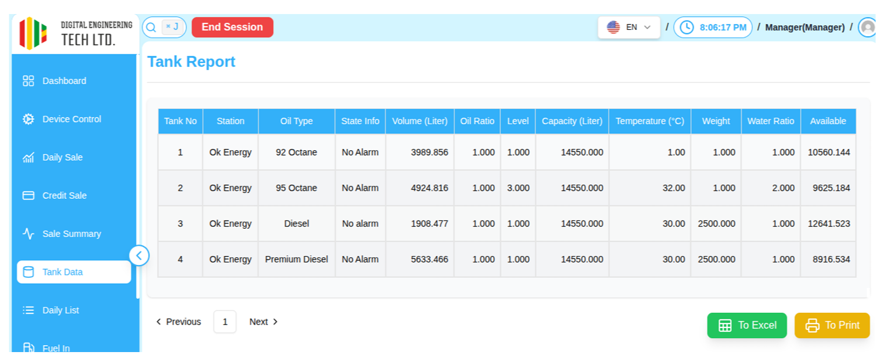

### Sale Summary

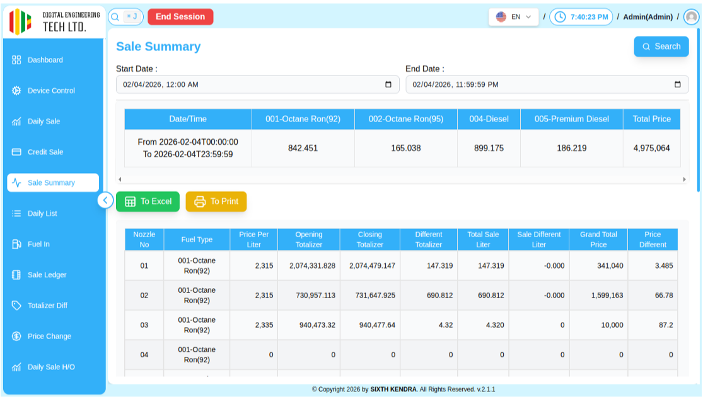

**ကြည့်ရှုလိုသောရက်ပိုင်းအခြားအတွက်**

* ဆီအမျိုးအစားတစ်ခုချင်းစီ၏ဆီရောင်းအား လီတာများ

* ဆီကန်တစ်ခုချင်းစီ၏ အရောင်းအမျျားနှင့် များ

* ဆီကန်တစ်ခုချင်းစီ၏ဆီရောင်းအားသားလီတာများ

* ဆီကန်တစ်ခုချင်းစီ၏ဆီရောင်းအားသားငွေပမာဏများ

* စုစုပေါင်းအရောင်းငွေများကို ကြည့်ရှုနိုင်မည် ဖြစ်ပါသည်။

* နှစ်ချုပ်၊ လချုပ်၊ အပတ်စဉ် စသည်ဖြင့် စာရင်း ဇယားများကို မိမိလိုသလို date များဖြင့် ပြောင်းလဲ၍ လိုအပ်သည့် စာရင်းများကို အလွယ်တကူ ရှာဖွေပြီး၊

* ကားနံပါတ်၊ ဆီအမျိုးအစား၊ မော်တော်ယာဉ်အမျိုးအစား၊ ရုံးတွင်းသုံး၊ ဆီကန်များ စစ်ဆေးေသာအခါ ကုန်သွားသောဆီပမာဏ နှင့် ဆီကန်တစ်ခုချင်းစီဖြင့် ဆော်လည်းကောင်း၊ စဉ်းဖြင့် မိမိလိုသလို စာရင်းဇယားများကို အလွယ်တကူ ယူစွပြီး လိုအပ်ပါက excel file အဖြစ် သို့မဟုတ် printer ဖြင့် ချိတ်ဆက်ပြီး print ထုတ်နိုင်မည် ဖြစ်ပါသည်။

### Daily List

* Station တွင်အသုံးပြု Vehicle များအတွက် ဖြည့်သွင်းထားသော ဆီပမာဏများ၊

* Pump စစ်ဆေးရန်အတွက် အသုံးပြုလိုက်ရသော ဆီပမာဏများ၊

* Credit ဖြင့် ရောင်းချထားသောစာရင်းများ စသည်တို့ကိုကြည့်ရှုနိုင်မည်ဖြစ်ပါသည်။

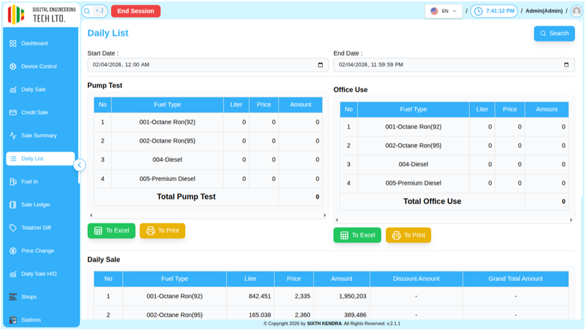

### Fuel In

ကြည့်ရှုလိုသော ရက်ရက်များ၏ ဆီကန်များမှ ဆီလက်ကျန်ဆိုင်ရာ အချက်အလက်များကို ဆီအမျိုးအစားတစ်ချင်းစီအလိုက်

* ဆီအရောင်းအဖွင့်အမှတ်များ

* ဆီအရောင်းလီတာများ

* ဆီလက်ကျန်လီတာများ စသည်တို့ကို ကြည့်ရှုနိုင်မည်။

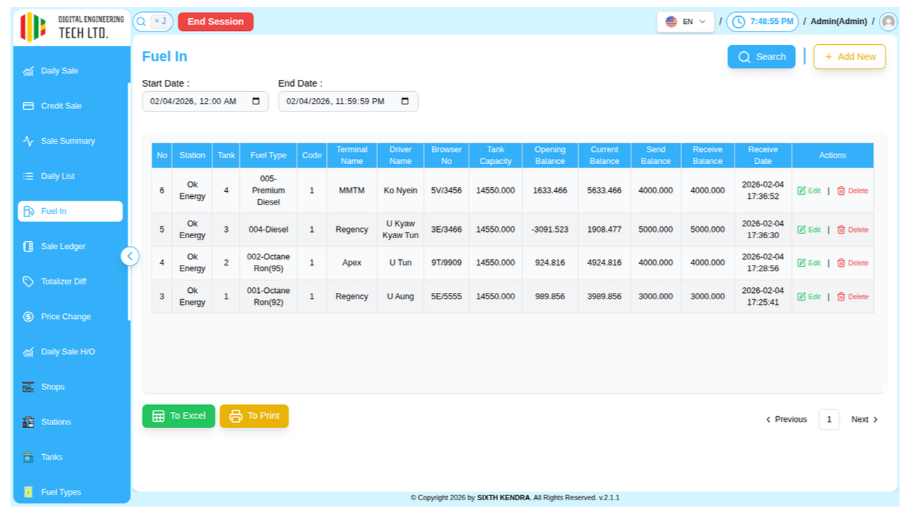

---

### Add New Fuel In ( Non-ATG Users )

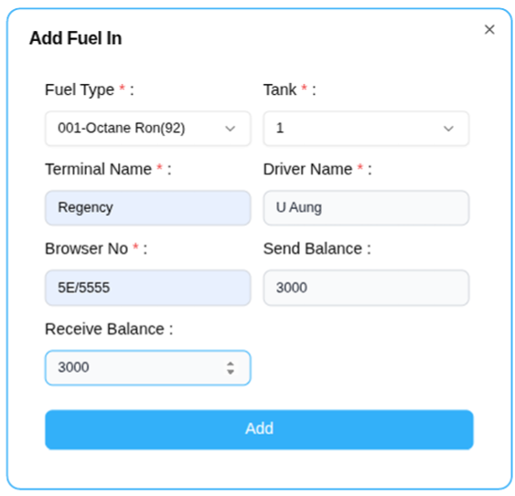

ATG မတပ်ဆင်ထားသည့်ဆိုင်ဖြစ်ပါက အောက်ဖော်ပြပါအတိုင်း Fuel In အား ဖြည့်သွင်းနိုင်မည်ဖြစ်သည် 

* Fuel In Page ၏ အပေါ်ပိုင်းဘက်ညာထောင့်ရှိ Add New ခလုတ်လေးအား နှိပ်ပါ။

* မိမိဆီဆိုင်အမည်၊ ဆီအမျိုးအစား၊ ဆီကန်အမှတ်များအပြင် အခြားသော လိုအပ်သည့်အချက်များကို ဖော်ပြပါ Form တွင် ပါရှိသည့်အတိုင်း ဖြည့်သွင်းပါ။

* လောင်စာဆီ ခွဲေမပ္ပဌာနမှ ခွဲပေးလိုက်သည့် စာရင်းပါဆီပမာဏအား Send Balance ၌လည်းကောင်း၊ ဆီကားမှဆီဖြည့်သည့်အချိန်၌ လက်ရှိလိုက်သည့်ဆီပမာဏအား Receive Balance ၌လည်းကောင်း မဖြစ်မနေဖြည့်သွင်းပေးရန်လိုအပ်ပါသည်။

---

* အချက်အလက်များကို မှန်ကန်စွာဖြည့်သွင်းပြီး၍ Create ခလုတ်လေးအား နှိပ်လိုက်ပါက Fuel In သွင်းသည့် Info အသေးစိတ်အား Record လုပ်သွားပေးမည်ဖြစ်ပါသည်။

* Start Date နှင့် End Date ၌ မိမိတို့ကြည့်ရှုလိုသည့် Fuel In အဝင်များကို ရက်ပိုင်းအခြားလိုက် ရှာဖွေမည်ဖြစ်ပါသည်။

* Record တစ်ခုရှိ Edit ခလုတ်အဆိပ်ရှိ၍ လိုအပ်သည့်အချက်အလက်များကိုပြင်ခြင်း၊ Delete ရှိ၍ Record ဖျက်ခြင်းတို့အား Permission ရှိသည့် User မှလုပ်ဆောင်နိုင်မည်ဖြစ်ပါသည်။

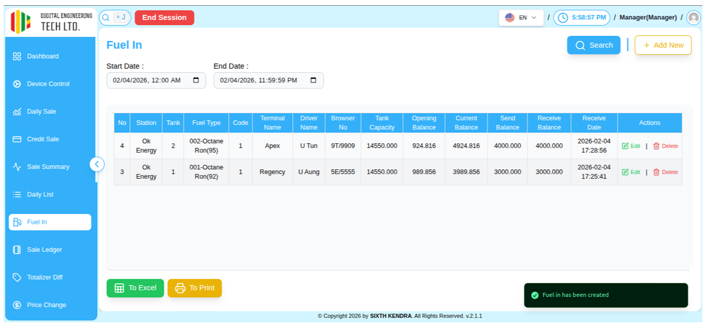

---

### Add New Fuel In ( ATG Users )

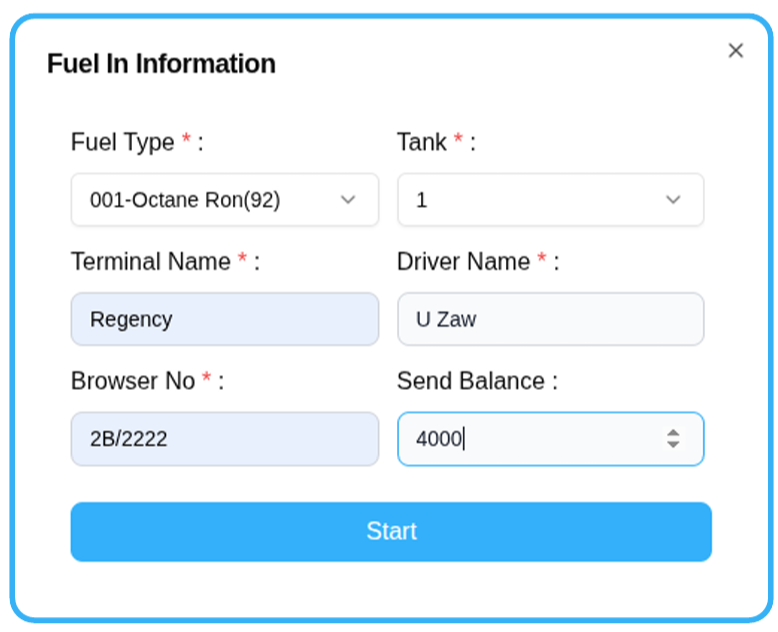

ATG တပ်ဆင်ထားသည့်ဆိုင်ဖြစ်ပါက အောက်ဖော်ပြပါအတိုင်း Fuel In အား ဖြည့်သွင်းနိုင်မည်ဖြစ်သည် -

* Fuel In Page ၏ အပေါ်ပိုင်းဘက်ညာထောင့်ရှိ + Add New ခလုတ်လေးအား နှိပ်ပါ။

* မိမိဆီဆိုင်အမည်၊ ဆီအမျိုးအစား၊ ဆီကန်အမှတ်များအပြင် အခြားသော လိုအပ်သည့်အချက်များကို ဖော်ပြပါ Form တွင် ပါရှိသည့်အတိုင်း ဖြည့်သွင်းပါ။

* ATG တပ်ဆင်ထားသည့်အတွက် အချို့သော Balance နှင့် သက်ဆိုင်သည့် အချက်အလက်များကိုဖြည့်ရန်လိုအပ်ဘဲ လောင်စာဆီ ခွဲေမပ္ပဌာနမှ ခွဲပေးလိုက်သည့် စာရင်းပါဆီပမာဏအား Send Balance ၌ Liter အဖြစ်ပြောင်းလဲ၍ ထည့်သွင်းရန်သာ လိုအပ်ပါသည်။

* အချက်အလက်များကို မှန်ကန်စွာဖြည့်သွင်းပြီး၍ Start ခလုတ်လေးအား နှိပ်လိုက်ပါက ဆီအဝင် သွင်းသည့် Initial Point အား ချိန် Record လုပ်သွားပေးမည်ဖြစ်ပြီး ဆီဖြည့်ပြီးသည့်အချိန်၌ End ခလုတ်လေးအား မဖြစ်မနေနှိပ်ပေးရန်လိုအပ်ပါသည်။

* သို့မှသာ ATG စက်မှတိုင်းတာစာရှိ ရရှိလာသည့်အချက်အလက်များကို တွက်ချက်၍ လက်ရှိရှိသည့်ဆီပမာဏ ( Receive Volume )၊ ဆီဖြည့်ပြီး ဆီကန်ရှိနေသော ဆီပမာဏ ( Tank Closing ) တို့အား Auto ဖြည့်သွင်းပေးသွားမည်ဖြစ်ပါသည်။

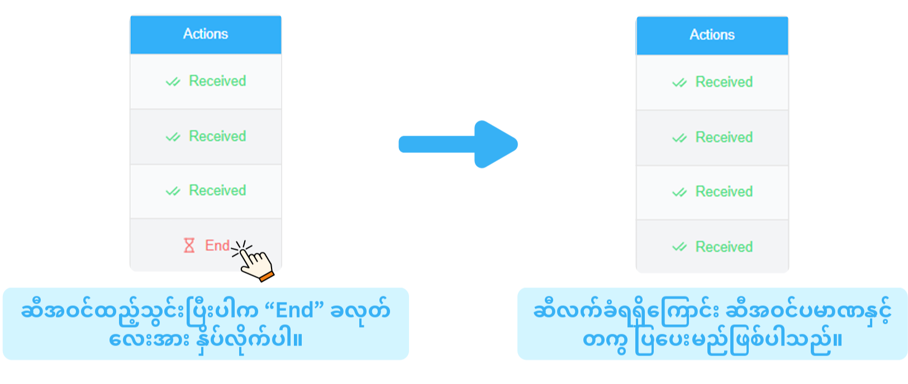

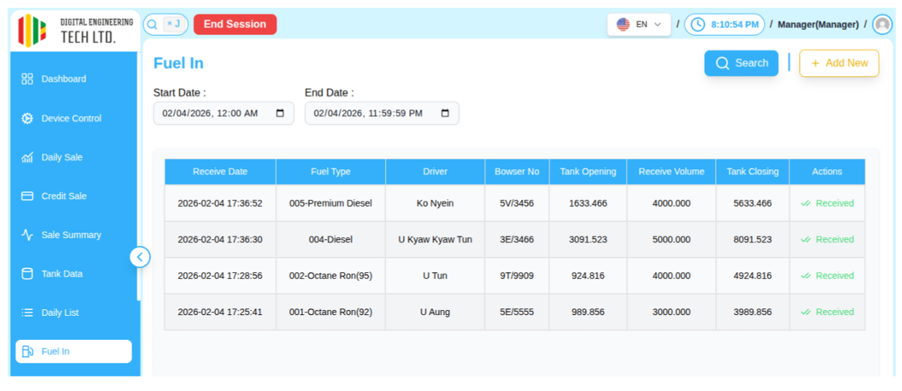

### Sale Ledger

* Sale Ledger ရှိ Meter Balance တွင် ဆီတစ်ကန်ချင်းစီ၏ Opening နှင့် Closing Balance များ၊ ဆီအရောင်းများကို နေ့ရက်အလိုက်ကြည့်ရှုနိုင်ပြီး၊

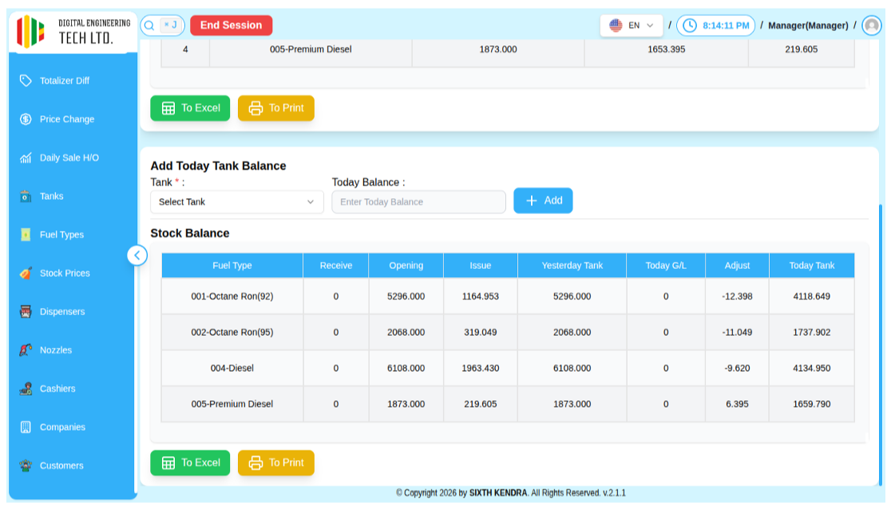

* ATG မတပ်ဆင်ထားသည့်ဆိုင်များတွင် နောက်တစ်နေ့နံနက်ပိုင်း၌ Opening Balance ယူ၍ လွယ်ကူစေရန်အတွက် Add Today Tank Balance တွင် ယနေ့ဆီဆိုင်သိမ်းချိန်တွင် တိုင်းတာရရှိလာသည့် ဆီပမာဏအား Tank အလိုက် ရွေးချ၍ ဖြည့်သွင်းနိုင်မည်ဖြစ်ပါသည်။

ဆီသိမ်းချိန်တွင် တိုင်းတာရရှိသော ကန်တိုင်းများအား “Sale Ledger Page” ၌ ထည့်ရာတွင် -

* Select Tank ၌ ကန်တိုင်းထည့်မည့်ကန်အား ရွေးပါ။

* Today Balance ၌ ကန်တိုင်းအား ထည့်၍ Add နှိပ်ကာ ထည့်သွင်းနိုင်ပါသည်။

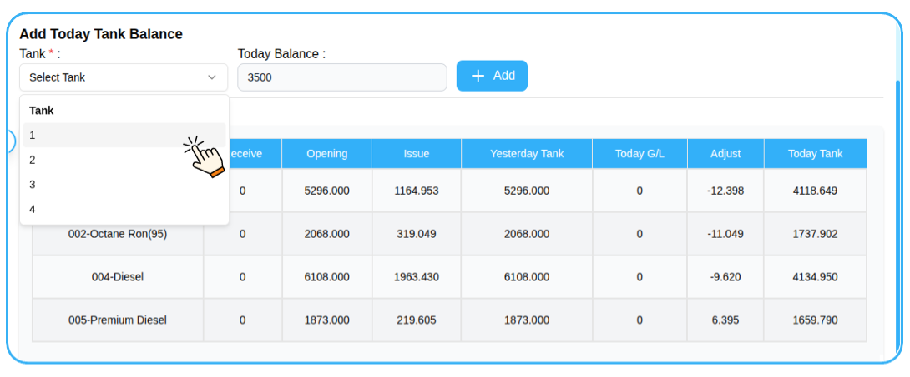

---

### Totalizer Difference

* Totalizer Difference ၌ ဆီကန်တစ်ကန်ချင်းစီ၏ စုစုပေါင်းအရောင်းလီတာများ၊ အရောင်းငွေပမာဏများ၊ နေ့ရက်အလိုက် Totalizer Opening နှင့် Closing တို့အား အလွယ်တကူရှာဖွေကြည့်ရှုနိုင်မည်ဖြစ်ပါသည်။

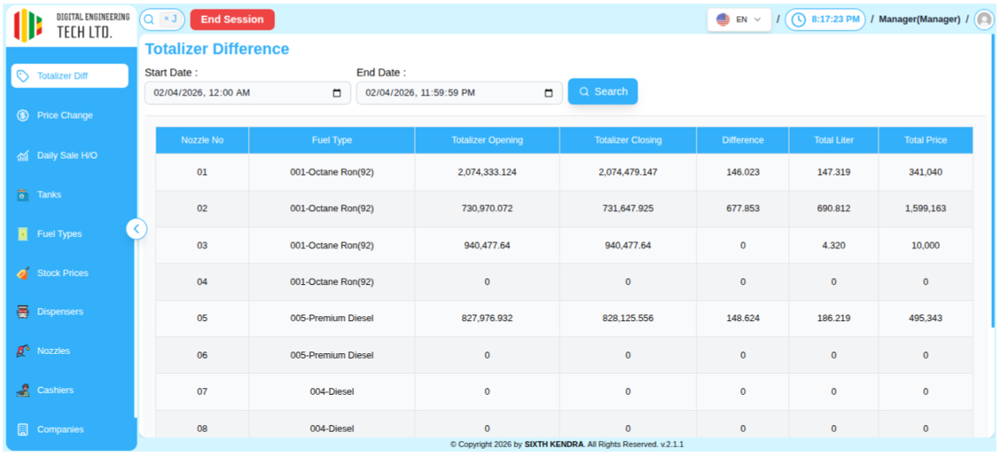

---

### Price Change

* ဆီ အမျိုးအစား တစ်ခုချင်းစီအလိုက် လိုအပ်သလို ဈေးနှုန်းများကို လွယ်ကူစွာ အပြောင်းအလဲ လုပ်နိုင်မည်။

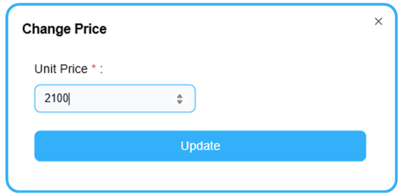

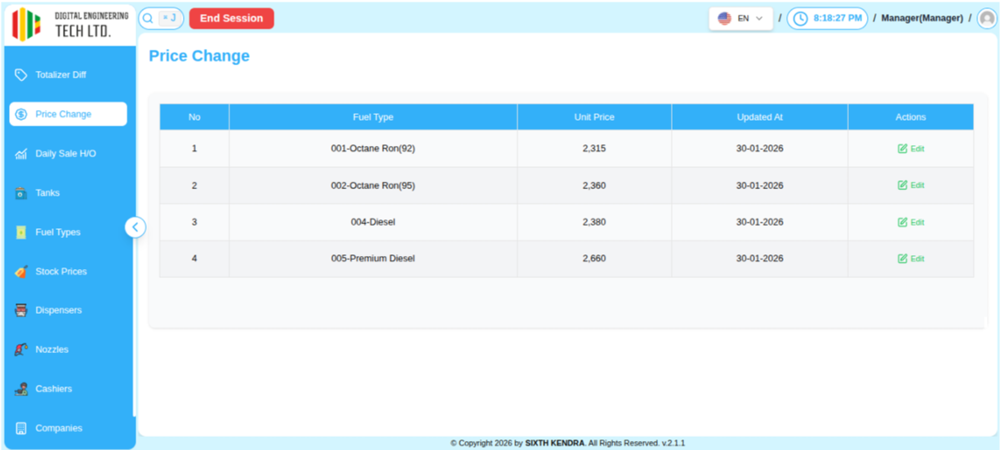

---

* နှစ်ချုပ်၊ လချုပ်၊ အပတ်စဉ် စသည့် စာရင်း ဇယားများကို “ To Excel ” button နှိပ်ကာ excel format နှင့် excel file အဖြစ်သို့ လည်းကောင်း၊

* လိုအပ်ပါက printer ဖြင့် ချိတ်ဆက်ကာ “ To Print ” button အား နှိပ်၍ဖြင့် စာရင်းဇယားများကို အလွယ်တကူ print ထုတ်ယူနိုင်မည် ဖြစ်သည်။

---

### Daily Sale H/O

* Daily Sale H/O ၌ ဆီအမျိုးအစားတစ်ခုချင်းစီအလိုက် ရောင်းချသည့် Payment Type များပေါ်မူတည်၍ နေ့ရက်အလိုက် အလွယ်တကူရှာဖွေကြည့်ရှုနိုင်မည်ဖြစ်ပါသည်။

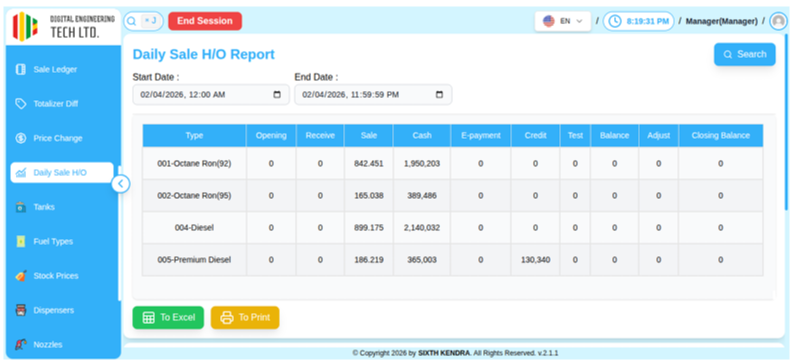
