## 7. Daily Sale

## Contents

- [7. Daily Sale](#7-daily-sale)
  - [Sales Information](#sales-information)
- [11. Credit Customers Auto-Selection](#11-credit-customers-auto-selection)
- [12. Accessibility of Sale Vouchers According to User Role](#12-accessibility-of-sale-vouchers-according-to-user-role)
  - [12.1 Admin Role](#121-admin-role)
  - [12.2 Manager Role](#122-manager-role)
  - [12.3 Cashier Role](#123-cashier-role)
- [Credit Sale](#credit-sale)
- [Credit Sales Payment Process](#credit-sales-payment-process)
    - [Using “Paid” Button](#using-paid-button)
    - [Using “Paid All” Button](#using-paid-all-button)
  - [Custom Payment Method](#custom-payment-method)

Daily Sale Report တွင် ဆီဆိုင်တစ်ဆိုင်ချင်းစီ၏ နေ့စဉ်ဆီရောင်းချမှုများကို Voucher တစ်စောင်ချင်းစီအလိုက် ကြည့်ရှုနိုင်မည်ဖြစ်သည်။

- ကြည့်ရှုလိုသည့် ရက်အပိုင်းအခြား၊ ဆီအသုံးပြုမှု၊ ဆီကန်အမှတ်နှင့် ဆီအမျိုးအစားတို့ကို Selection Box များမှ ရွေးချယ်၍ လိုအပ်သည့် အရောင်းစာရင်းများကို ကြည့်ရှုနိုင်မည်ဖြစ်သည်။

- Voucher များကို Edit ပြုလုပ်ရာတွင် Vehicle Type ရွေးချယ်ခြင်း၊ Car No. ပြင်ဆင်ခြင်း၊ Payment Method ရွေးချယ်ခြင်းနှင့် Discount ကို Amount သို့မဟုတ် Percent ဖြင့် သတ်မှတ်ခြင်းတို့ကို ပြုလုပ်နိုင်မည်ဖြစ်သည်။

အချက်အလက်များ ပြင်ဆင်ပြီးပါက **Save & Print** ကို နှိပ်ခြင်းဖြင့် အချက်အလက်များကို သိမ်းဆည်းပြီး Voucher ကို တစ်ခါတည်း Print ထုတ်နိုင်မည်ဖြစ်သည်။

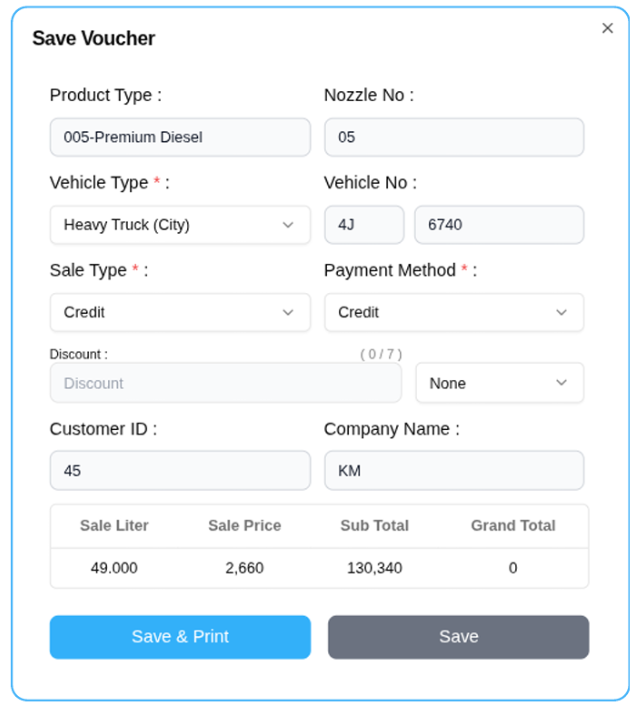

### Sales Information

- Nozzle မှ ရောင်းချထားသည့် ဈေးနှုန်း၊ လီတာ၊ သင့်ငွေနှင့် Totalizer အမှတ် စသည်တို့ကို Dispenser မှ ပေးပို့လာသော အချက်အလက်များအတိုင်း သိမ်းဆည်းပြသပေးမည်ဖြစ်သည်။

- ရက်အပိုင်းအခြား၊ အချိန်အပိုင်းအခြား၊ ဆီအသုံးပြုမှု၊ ဆီကန်တစ်ကန်ချင်းစီနှင့် ဆီအမျိုးအစားတစ်ခုချင်းစီအလိုက် Selection Box များမှ ရွေးချယ်၍ အရောင်းစာရင်းများကို ကြည့်ရှုနိုင်မည်ဖြစ်သည်။

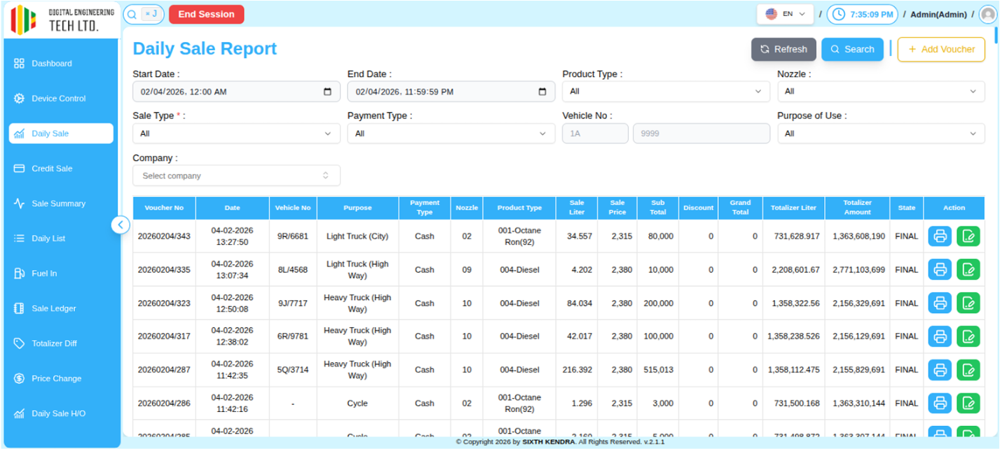

## 11. Credit Customers Auto-Selection

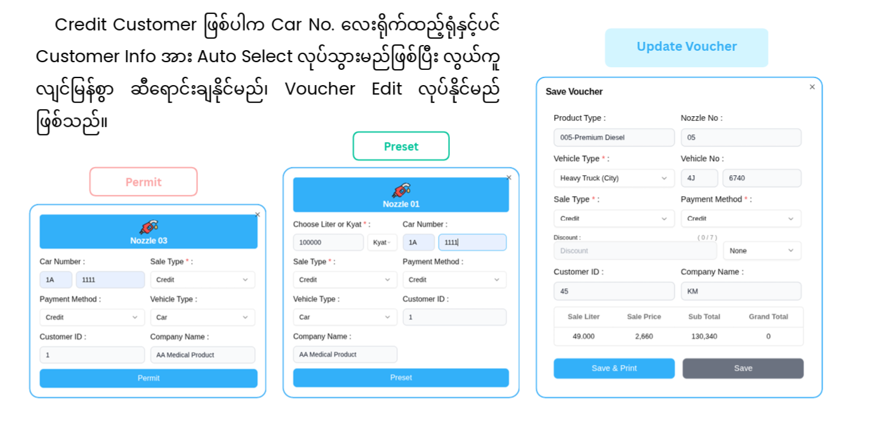

---

## 12. Accessibility of Sale Vouchers According to User Role

Credit Sale များကို Priority မြင့်သော User များသာ ကိုင်တွယ်ခွင့်ရရှိစေရန် Admin, Manager နှင့် Cashier ဟူ၍ User Role များ ခွဲခြားသတ်မှတ်ထားသည်။

### 12.1 Admin Role

Admin Role သည် Sale Voucher များနှင့် Credit Sale များကို Access လုပ်နိုင်သည့် အမြင့်ဆုံး Permission ရှိသော Role ဖြစ်သည်။

- ပုံမှန် Sale Voucher များကို Access လုပ်နိုင်သည်။

- Credit Sale Voucher များကိုလည်း Access လုပ်နိုင်သည်။

- မည်သည့်အချိန်တွင်မဆို Voucher များကို Edit ပြုလုပ်နိုင်သည်။

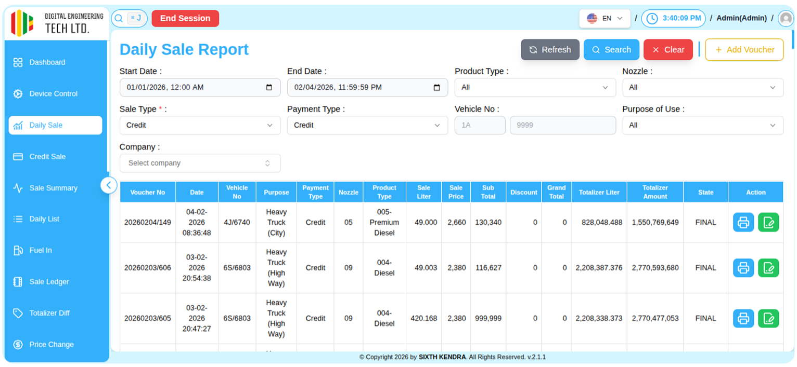

### 12.2 Manager Role

Manager Role သည် Credit Sale များကို Access လုပ်ခွင့်မရှိဘဲ ယနေ့ရက်စွဲအတွင်းရှိ ပုံမှန်အရောင်းစာရင်းများကိုသာ Edit ပြုလုပ်နိုင်သည်။

- ပုံမှန် Sale Voucher များကို ကြည့်ရှုနိုင်သည်။

- ယနေ့၏ Sale Voucher များကိုသာ Edit ပြုလုပ်နိုင်သည်။

- နောက်ရက်သို့ ရောက်ရှိသွားပါက ယခင်နေ့၏ Voucher များကို Edit ပြုလုပ်ခွင့်မရှိပါ။

- Credit Sale များကို Access လုပ်ခွင့်မရှိပါ။

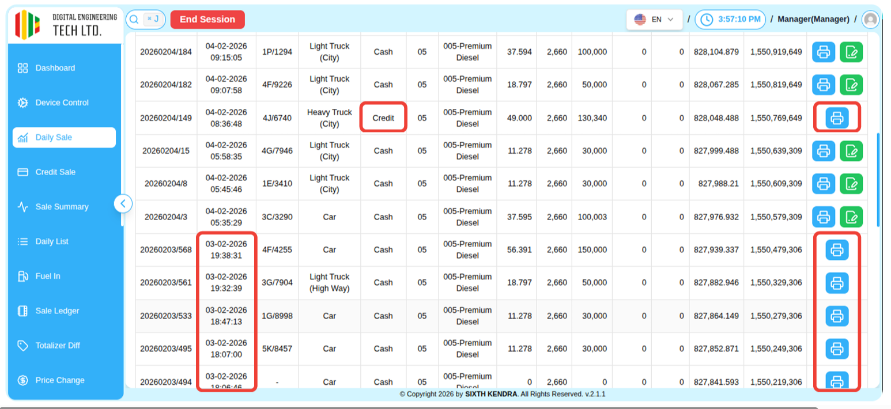

> **📌 အထူးသတိပြုရန် (Important Notice)**

>

> Credit Sale များ၏ Vehicle Information မှားယွင်းနေပါက Manager နှင့် Cashier တို့သည် Software မှတစ်ဆင့် ကိုယ်တိုင်ပြင်ဆင်နိုင်ခြင်းမရှိပါ။

>

> ထိုသို့ဖြစ်ပေါ်ပါက ရုံးချုပ်သို့ ဆက်သွယ်အကြောင်းကြားရမည်ဖြစ်သည်။ ရုံးချုပ်မှ NetBird ဖြင့် ချိတ်ဆက်ပြီး Admin Account အသုံးပြု၍သာ လိုအပ်သော အချက်အလက်များကို ပြင်ဆင်ပေးနိုင်မည်ဖြစ်သည်။

### 12.3 Cashier Role

Cashier Role သည် Device Control Page တွင် Vehicle Type ရွေးချယ်ခြင်းနှင့် Car No. ဖြည့်သွင်းခြင်းတို့ကိုသာ လုပ်ဆောင်နိုင်သည်။

- Vehicle Type ရွေးချယ်နိုင်သည်။

- Car No. ဖြည့်သွင်းနိုင်သည်။

- Save ပြုလုပ်နိုင်သည်။

- Save ပြုလုပ်ပြီးနောက် Voucher ကို ပြန်လည် Edit လုပ်ခွင့်မရှိပါ။

- Manager ကဲ့သို့ Credit Sale များကို Access လုပ်ခွင့်မရှိပါ။

Vehicle Information မှားယွင်းဖြည့်သွင်းမိပါက Priority မြင့်သော Admin သို့မဟုတ် သက်ဆိုင်ရာ တာဝန်ရှိသူထံ ပြင်ဆင်ပေးရန် တောင်းဆိုရမည်ဖြစ်သည်။

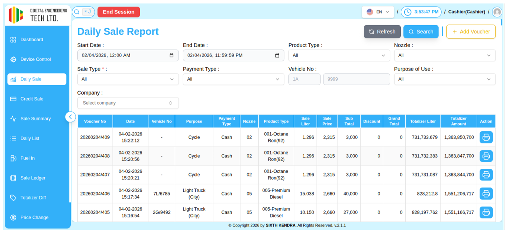

## Credit Sale

* Credit Sale Page ၌ မိမိတို့ဆီဆိုင်၏ Credit Customer တစ်ဦးချင်းစီအား မြင်တွေ့နိုင်မည်ဖြစ်ပြီး Car No., Company Name ဖြင့်လည်း Customer အား ရှာဖွေနိုင်မည်ဖြစ်သည်။

* View ခလုတ်လေးအား နှိပ်လိုက်မည်ဆိုပါက အဆိုပါ Credit Customer မှ ဆီဆိုင်၌ဆီလာဖြည့်သည့် စာရင်းေယားနှင့် ပြန်ပေးငွေပမာဏများကို နေ့ရက်အလိုက်ရှာဖွေ စစ်ဆေးနိုင်မည်ဖြစ်ပါသည်။

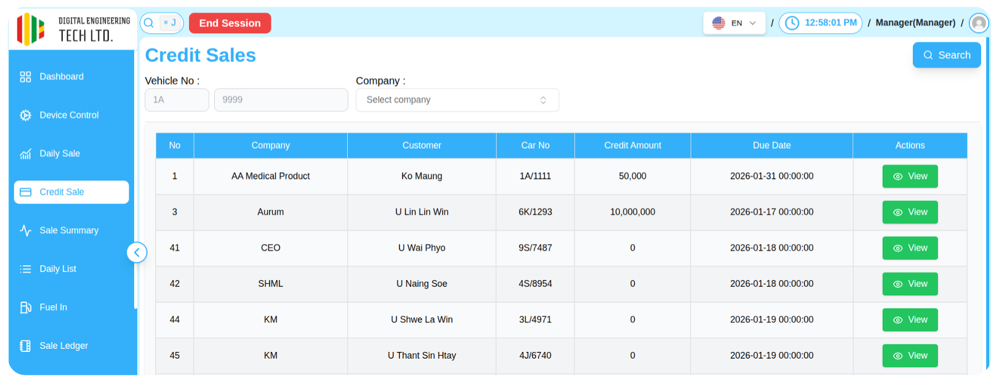

* Credit Customer မှ ပြန်ပေးငွေပေးလာသည်ဆိုပါက Paid ခလုတ်လေးအား နှိပ်၍ ပြန်ပေးမည့်ငွေပမာဏ ( Return Amount ) နှင့် ပြန်ပေးငွေအသုံးပြုသည့်နေ့ ( Return Date ) အား Update လုပ်ကာ မှတ်တမ်းတင်ထားနိုင်မည်ဖြစ်ပါသည်။

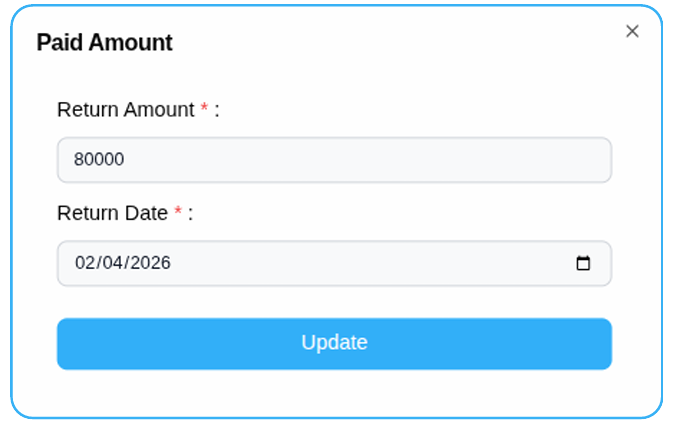

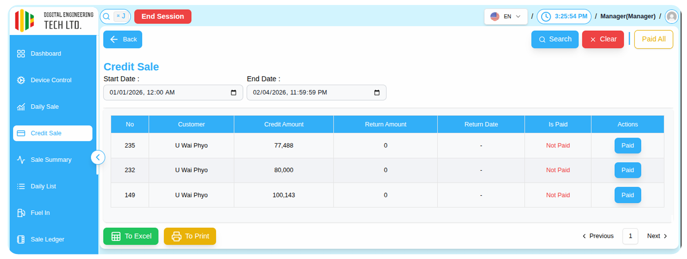

* **Paid All:** Customer မှ Credit ဖြင့်ရောင်းချထားသည့်အရောင်းအားလုံးအား တစ်ခေါက်တည်းဖြင့်ငွေအကျေချေသည့်အခါ Paid All ဖြင့်အသုံးပြုနိုင်ပါသည်။

* **Paid:** Customer မှ Credit ဖြင့်ရောင်းချထားသည့်အရောင်းတစ်ကြောင်းစီအား ငွေချေပါက အရောင်းတစ်ကြောင်းစီအလိုက် Paid ဖြင့်အသုံးပြု၍ ငွေချေနိုင်ပါသည်။

## Credit Sales Payment Process

#### Using “Paid” Button

* “Paid” Button ဖြင့် ငွေပေးချေရာတွင် သက်ဆိုင်ရာ Credit အရောင်းတစ်စောင်ချင်းအား ငွေအောက်ကတ်အတိအကျရှိက ထည့်ပေးမှသာ ပေးချေနိုင်မည်ဖြစ်ပါသည်။

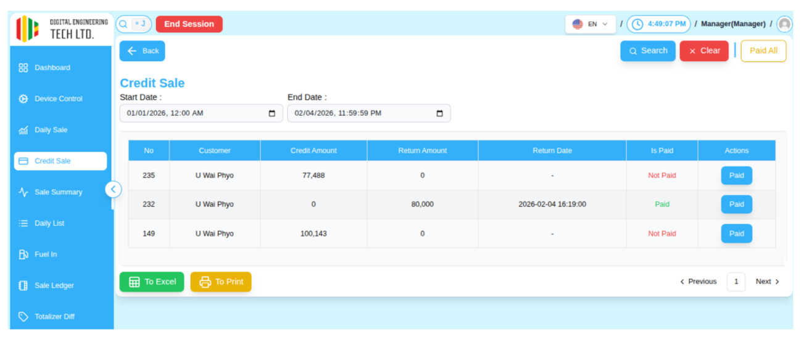

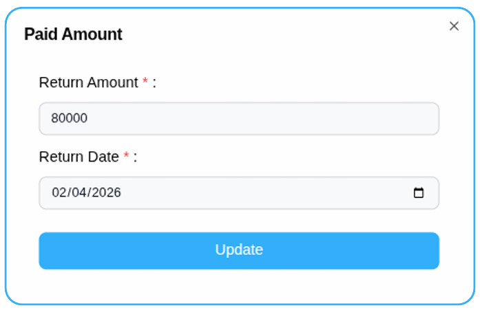

#### Using “Paid All” Button

* “Paid” Button ဖြင့် ငွေပေးချေရာတွင် Credit ဖြစ်နေသည့် Amount စုစုပေါင်းအား တစ်ခေါက်တည်းဖြင့် ငွေပေးချေနိုင်မည်ဖြစ်ပါသည်။

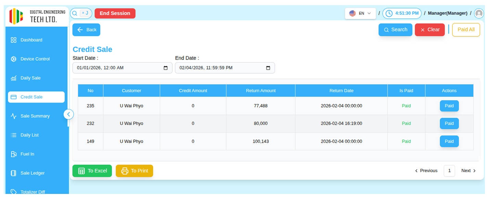

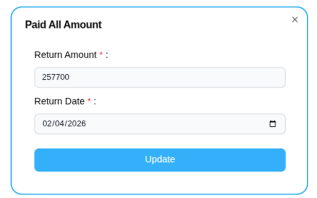

### Custom Payment Method

* “Paid All” Button ဖြင့် ငွေပေးချေရာတွင် Customer မှ ငွေအပြည့်မချေလိုသေးသည့်အခါ နှစ်သက်ရာငွေအောက်ကန်အား ရိုက်ထည့်လိုက်ပါက Credit ပေးရန်ကျန်ငွေနှင့် ပြန်အပ်ငွေ အမောက်တို့ကို အီးသန့်ခွဲ၍တွက်ထုတ်ပေးသွားမည် ဖြစ်ပါသည်။

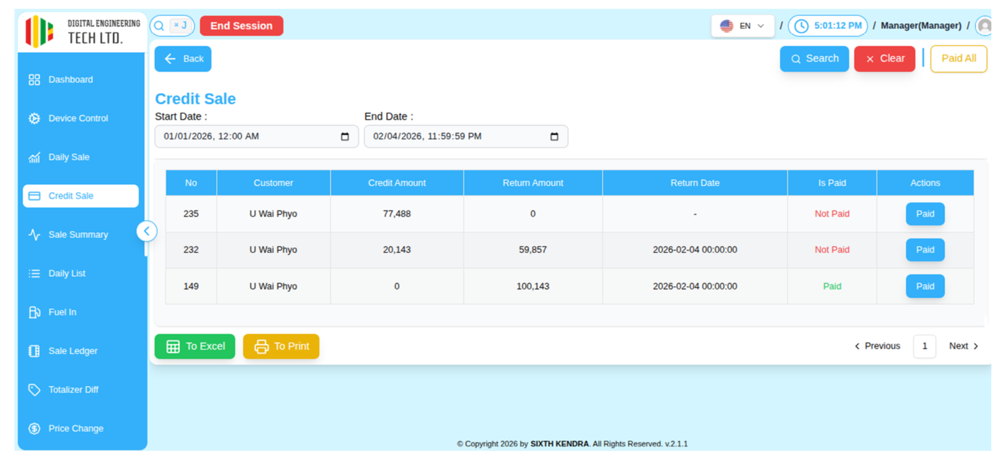

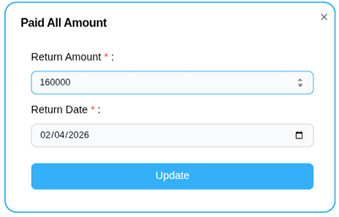
