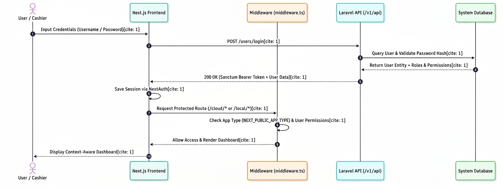

# Authentication and Authorization Workflow

## 1. Overview

The Authentication and Authorization Workflow describes the steps involved in authenticating a user (e.g., Cashier) and securing route access in the **Fuel Management System (FMS)**.

It illustrates the interaction between the **User / Cashier**, **Next.js Frontend**, **Middleware (`middleware.ts`)**, **Laravel API (`/v1/api`)**, and the **System Database** during login and protected route handling.

---

## 2. Workflow Diagram

The following sequence diagram illustrates the step-by-step interactions between components during the authentication and route authorization process:

*Figure 1: Authentication and Authorization Sequence Diagram*

---

## 3. Workflow Steps

* **Credentials Input:** The user/cashier enters their credentials (Username / Password) into the Next.js Frontend.
* **Login Request:** The frontend submits a `POST /users/login` request to the backend Laravel API (`/v1/api`).
* **Database Validation:** The Laravel API queries the System Database to verify the user record and validate the password hash.
* **User Entity Retrieval:** The database returns the matching User Entity along with their associated Roles and Permissions.
* **Token Issuance:** The Laravel API returns a `200 OK` response containing the Sanctum Bearer Token and User Data.
* **Session Storage:** The Next.js frontend securely stores the session data utilizing NextAuth.
* **Protected Route Request:** The user navigates to a protected route (e.g., `/cloud/*` or `/local/*`).
* **Middleware Verification:** The Next.js `middleware.ts` intercepts the request and verifies:
    - Application Type (`NEXT_PUBLIC_APP_TYPE`)
    - User Permissions
* **Route Grant:** The middleware allows access and initiates the rendering of the dashboard.
* **Dashboard Render:** The Next.js frontend presents the context-aware dashboard to the user/cashier.

---

## 4. Technical Summary

| Component | Role in Authentication |
| :--- | :--- |
| **Next.js Frontend** | Handles login UI, manages user sessions via NextAuth, and renders context-aware views. |
| **Middleware (`middleware.ts`)** | Performs client-side route protection based on app environment variables and session permissions. |
| **Laravel API (`/v1/api`)** | Handles authentication logic, verifies passwords, and issues Sanctum Bearer Tokens. |
| **System Database** | Stores user credentials, roles, and authorization permissions. |

---

## 5. Expected Result

Upon successful validation, the user receives a Laravel Sanctum Bearer Token stored within NextAuth. Subsequent navigation through protected routes is validated at the middleware layer, rendering a context-aware interface corresponding to the cashier's assigned permissions.