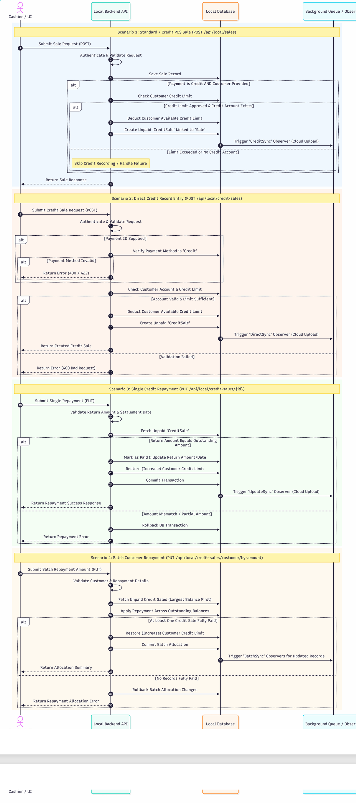

# Credit Sale and Repayment Workflow

## 1. Overview

The Credit Sale and Repayment Workflow describes how credit sales are created, customer credit limits are managed, and outstanding credit balances are settled in the Fuel Management System (FMS).

The workflow involves the Cashier / UI, Local Backend API, Local Database, and Background Queue / Observer.

It covers four main scenarios:

- **Standard / Credit POS Sale:** Processes a regular POS sale and handles additional credit-related operations when the payment method is credit.
- **Direct Credit Sale Entry:** Creates a credit sale directly through the credit sales API.
- **Single Credit Repayment:** Processes a repayment against an individual unpaid credit sale.
- **Batch Customer Repayment:** Allocates a repayment amount across multiple outstanding credit sales.

---

## 2. Workflow Diagram

The following sequence diagram illustrates the interactions between the cashier interface, backend API, database, and background processing components during credit sales and repayment operations.

*Figure 1: Credit Sale and Repayment Sequence Diagram*

---

## 3. Workflow Steps

### 3.1 Standard / Credit POS Sale

**API Endpoint:** `POST /api/local/sales`

1. **Submit Sale Request:** The cashier submits a sales request through the UI.
2. **Authenticate and Validate:** The Local Backend API authenticates the request and validates the submitted data.
3. **Save Sale Record:** The API saves the sale record in the Local Database.
4. **Check Credit Payment Conditions:** If the payment method is credit and customer information is provided, the system checks the customer's credit limit.
5. **Validate Credit Account:** The system checks whether the customer has a valid credit account and sufficient available credit.
6. **Deduct Available Credit:** If the account is valid and the credit limit is approved, the customer's available credit limit is reduced.
7. **Create Unpaid Credit Sale:** The system creates an unpaid `CreditSale` record linked to the original `Sale`.
8. **Trigger Cloud Synchronization:** The `CreditSync` observer is triggered to upload the relevant record to the cloud.
9. **Handle Credit Failure:** If the credit limit is exceeded or no valid credit account exists, the diagram indicates that credit recording is skipped or the failure is handled.
10. **Return Sale Response:** The API returns the sale response to the cashier UI.

### 3.2 Direct Credit Sale Entry

**API Endpoint:** `POST /api/local/credit-sales`

1. **Submit Credit Sale Request:** The cashier submits a direct credit sale request.
2. **Authenticate and Validate:** The API authenticates the request and validates the submitted data.
3. **Verify Payment Method:** When a payment ID is supplied, the system verifies that the payment method is `Credit`.
4. **Handle Invalid Payment Method:** If the payment method is invalid, the diagram indicates an error response with HTTP status `400` or `422`.
5. **Check Customer Account and Credit Limit:** The system checks the customer account and available credit limit.
6. **Deduct Available Credit:** If the account is valid and the limit is sufficient, the customer's available credit limit is reduced.
7. **Create Unpaid Credit Sale:** The API creates an unpaid `CreditSale` record.
8. **Trigger Cloud Synchronization:** The `DirectSync` observer is triggered for cloud upload.
9. **Return Result:** The API returns the created credit sale or a validation error, depending on the outcome.

### 3.3 Single Credit Repayment

**API Endpoint:** `PUT /api/local/credit-sales/{id}`

1. **Submit Repayment Request:** The cashier submits a repayment request for a specific credit sale.
2. **Validate Repayment Details:** The API validates the repayment amount and settlement date.
3. **Fetch Unpaid Credit Sale:** The system retrieves the outstanding `CreditSale` record.
4. **Check Outstanding Amount:** The repayment amount is compared with the outstanding amount.
5. **Mark Credit Sale as Paid:** If the repayment amount equals the outstanding amount, the system updates the payment status and repayment amount/date.
6. **Restore Customer Credit Limit:** The customer's available credit limit is increased.
7. **Commit Transaction:** The database transaction is committed.
8. **Trigger Cloud Synchronization:** The `UpdateSync` observer is triggered for cloud upload.
9. **Return Result:** The API returns a repayment success response.
10. **Handle Amount Mismatch:** If the amount does not match the outstanding amount, the diagram indicates that the database transaction is rolled back and a repayment error is returned.

### 3.4 Batch Customer Repayment

**API Endpoint:** `PUT /api/local/credit-sales/customer/{by-amount}`

1. **Submit Batch Repayment:** The cashier submits a repayment amount for a customer.
2. **Validate Repayment Details:** The API validates the customer and repayment information.
3. **Fetch Outstanding Credit Sales:** The system retrieves unpaid credit sales, starting with the largest outstanding balance first, as indicated in the diagram.
4. **Allocate Repayment Amount:** The repayment amount is applied across the outstanding balances.
5. **Check Settlement Result:** The system checks whether at least one credit sale has been fully paid.
6. **Restore Customer Credit Limit:** The customer's available credit limit is increased according to the processed repayment.
7. **Commit Batch Allocation:** The database commits the batch allocation changes.
8. **Trigger Cloud Synchronization:** `BatchSync` observers are triggered for updated records.
9. **Return Allocation Summary:** The API returns a summary of the repayment allocation.
10. **Handle Incomplete Allocation:** If no records are fully paid, the diagram indicates that the batch allocation changes are rolled back and a repayment allocation error is returned.

---

## 4. Technical Summary

| Component | Responsibility |
|---|---|
| **Cashier / UI** | Submits POS sales, direct credit sale requests, and repayment requests. |
| **Local Backend API** | Authenticates requests, validates input, applies credit sale logic, and processes repayments. |
| **Local Database** | Stores sale records, credit sale records, customer credit limits, and repayment updates. |
| **Background Queue / Observer** | Initiates background synchronization for credit sales, repayment updates, and batch allocation changes. |

### API Endpoints

| Operation | HTTP Method | Endpoint |
|---|---|---|
| Standard / Credit POS Sale | `POST` | `/api/local/sales` |
| Direct Credit Sale Entry | `POST` | `/api/local/credit-sales` |
| Single Credit Repayment | `PUT` | `/api/local/credit-sales/{id}` |
| Batch Customer Repayment | `PUT` | `/api/local/credit-sales/customer/{by-amount}` |

---

## 5. Expected Result

After a successful credit POS sale or direct credit sale, the system records the relevant sale information, updates the customer's available credit limit, and creates an unpaid credit sale record where applicable.

For a successful single repayment, the system updates the relevant credit sale and restores the customer's available credit limit according to the repayment logic.

For a batch repayment, the system allocates the repayment amount across outstanding credit sales and returns an allocation summary when the operation succeeds.

The sequence diagram also shows observer-triggered cloud synchronization for relevant records. Error scenarios include invalid payment methods, credit limit failures, repayment amount mismatches, and unsuccessful batch allocations.

---

## 6. Related Documentation

- [System Architecture](../architecture.md)
- [API Documentation](../api.md)
- [Database Design](../database.md)
- [Authentication & Authorization](../authentication.md)
- [Sales Transaction Workflow](sales.md)
- [Business Logic & Formulas](../formulas/sales.md)
