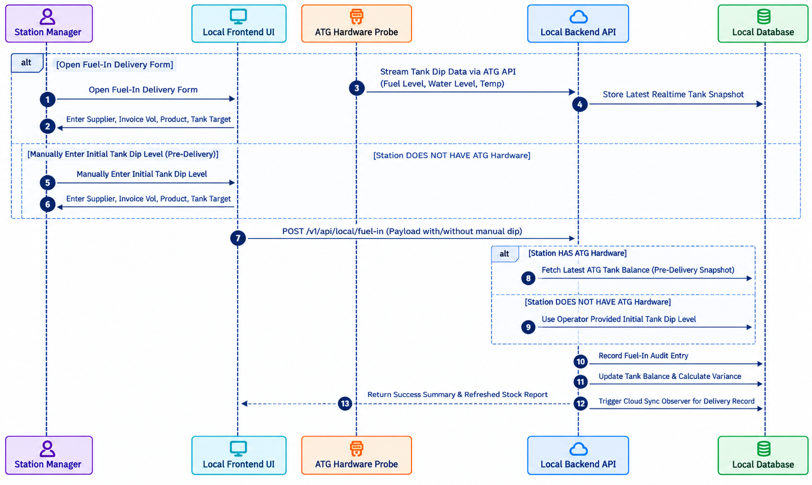

# Fuel-In Delivery & Stock Management Workflow

## 1. Overview

The Fuel-In Workflow describes the steps involved in recording fuel deliveries, tracking tank dip levels, and updating inventory balances in the **Fuel Management System (FMS)**.

It illustrates the interaction between the **Station Manager**, **Local Frontend UI**, **Local Laravel Backend**, **ATG Hardware Probe**, **System Database**, and background sync observers during a fuel delivery transaction.

## 2. Workflow Diagram

The following sequence diagram illustrates the interaction between system components during fuel delivery and stock setup.

**Figure 1: Fuel-In Sequence Diagram**

## 3. Workflow Steps

### Automated Tank Monitoring (Station HAS ATG Hardware)

* **Stream Tank Dip Data:** The ATG Hardware Probe streams real-time tank metrics (Fuel Level, Water Level, Temperature) via the ATG API to the Local Laravel Backend.
* **Store Tank Snapshot:** The Local Backend logs the latest real-time tank snapshot into the Local Database.

### Delivery Data Entry

#### Scenario A: Station HAS ATG Hardware
* The Station Manager opens the **Fuel-In Delivery Form** on the Local Frontend UI.
* The manager enters the supplier, invoice volume, fuel product type, and target tank.

#### Scenario B: Station DOES NOT HAVE ATG Hardware
* The Station Manager opens the **Fuel-In Delivery Form** on the Local Frontend UI.
* The manager manually inputs the initial pre-delivery tank dip level.
* The manager enters the supplier, invoice volume, fuel product type, and target tank.

## Fuel-In Processing & Execution

* **Submit Fuel-In Request:** The Local Frontend UI submits a POST request to `/v1/api/local/fuel-in` with the delivery payload (with or without manual dip reading).
* **Fetch Pre-Delivery Snapshot:** 
    **With ATG Hardware:** The backend fetches the latest automated ATG tank balance snapshot. 
    **Without ATG Hardware:** The backend uses the operator-provided initial tank dip level.
* **Record Audit Entry:** The backend logs a detailed fuel-in audit entry in the Local Database.
* **Update Stock & Calculate Variance:** The system recalculates total tank volume, updates balances in the Local Database, and computes delivery variance.
* **Trigger Cloud Sync:** The system triggers the Eloquent Model Observer to queue a background job (`Dispatch SyncTransactionCloud`) for synchronizing delivery data with the central cloud database.
* **Return Summary:** The backend returns a success summary and refreshed stock report to the Local Frontend UI for display to the Station Manager.

## 4. Expected Result

The fuel delivery is accurately recorded, local tank balances and variance calculations are updated, and background queue jobs are dispatched to synchronize the transaction to the central cloud platform.