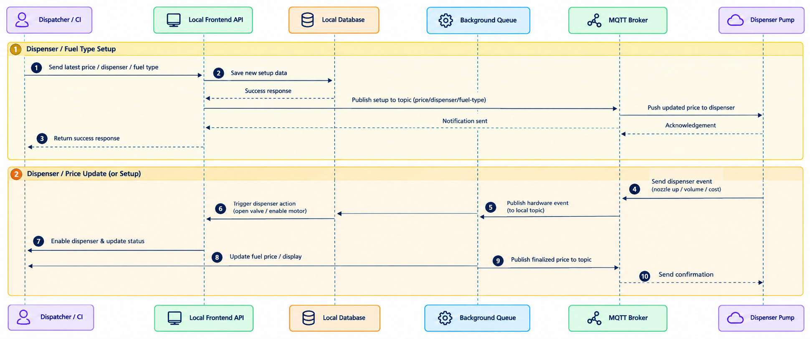

# Dispenser Setup and Price Update Workflow

## 1. Overview

The Dispenser Setup and Price Update Workflow describes how dispenser configuration and fuel price information are submitted, stored, and communicated to the physical dispenser.

The workflow involves the Dispatcher / CI, Local Frontend API, Local Database, Background Queue, MQTT Broker, and Dispenser Pump.

It covers two main processes:

- **Dispenser / Fuel Type Setup:** Saving dispenser configuration and publishing the setup information through MQTT.
- **Dispenser Event and Price Update:** Processing dispenser events, triggering the relevant dispenser actions, and communicating price updates.

## 2. Preconditions

Before this workflow begins, the following conditions should be satisfied:

- The station application and required backend services are available.
- The Local Frontend API can communicate with the Local Database.
- The MQTT Broker is configured for the relevant system components.
- The Dispenser Pump is connected to the station's hardware communication system.
- The required dispenser and fuel type information is available.

*Note: These preconditions should be verified against the actual system configuration.*

## 3. Workflow Diagram

The following sequence diagram illustrates the interactions between the system components during dispenser setup, fuel type configuration, dispenser event processing, and fuel price updates.

*Figure 1: Dispenser Setup and Price Update Sequence Diagram*

## 4. Workflow Steps

### 4.1 Dispenser / Fuel Type Setup

1. **Submit Setup Information:** The Dispatcher / CI sends the latest fuel price, dispenser information, and fuel type to the Local Frontend API.
2. **Save Configuration:** The Local Frontend API sends the setup information to the Local Database for storage.
3. **Return Database Response:** The Local Database returns a response indicating the result of the save operation.
4. **Publish Setup Message:** The system publishes the setup information through the MQTT Broker using the topic shown in the sequence diagram: `price/dispenser/fuel-type`.
5. **Update Dispenser:** The MQTT Broker forwards the updated information to the Dispenser Pump.
6. **Receive Acknowledgement:** The Dispenser Pump sends an acknowledgement through the MQTT Broker.
7. **Return API Response:** The Local Frontend API returns the setup operation's response to the Dispatcher / CI.

### 4.2 Dispenser Event Processing

1. **Send Dispenser Event:** The Dispenser Pump sends a hardware event, such as nozzle-up, volume, or cost information.
2. **Publish Hardware Event:** The event is communicated through the MQTT Broker to the relevant local topic.
3. **Trigger Processing:** The Background Queue participates in the event-processing flow shown in the sequence diagram.
4. **Trigger Dispenser Action:** The system initiates the corresponding dispenser action, such as opening the valve or enabling the motor.
5. **Update Dispenser Status:** The system updates the dispenser status through the relevant application flow.
6. **Update Fuel Price or Display:** The system processes the fuel price or display update.
7. **Publish Finalized Price:** The Background Queue publishes the finalized price through the MQTT Broker.
8. **Send Confirmation:** The Dispenser Pump receives a confirmation message through the MQTT communication flow.

## 5. Alternative Scenarios and Error Handling

The sequence diagram primarily illustrates the setup and update flows. It does not fully specify the system's error-handling behavior.

The following scenarios should be documented after verification against the implementation:

- **Database Save Failure:** What response is returned if the setup information cannot be saved?
- **MQTT Connection Failure:** How does the system handle a failed or unavailable MQTT connection?
- **Dispenser Acknowledgement Timeout:** What happens if the dispenser does not acknowledge an update?
- **Hardware Communication Failure:** How is a failed dispenser action reported or recovered?
- **Price Update Failure:** How does the system determine whether the price was successfully applied to the physical dispenser?

These behaviors should only be described as implemented features when confirmed by the source code or system tests.

## 6. Technical Summary

| Component | Responsibility |
|---|---|
| **Dispatcher / CI** | Submits dispenser configuration and fuel price information. |
| **Local Frontend API** | Receives setup requests, coordinates application operations, and returns responses. |
| **Local Database** | Stores the setup information submitted through the API. |
| **Background Queue** | Participates in background processing related to dispenser events and price updates. |
| **MQTT Broker** | Transports setup messages, hardware events, and price update messages between system components. |
| **Dispenser Pump** | Receives configuration or price updates and sends hardware events and acknowledgements. |

## 7. Expected Result

After the setup operation is processed, the dispenser configuration is stored in the Local Database and the relevant setup information is published through MQTT.

During dispenser event processing, hardware events are communicated through the MQTT Broker and the corresponding processing flow is triggered.

The workflow also includes the publication of finalized price information and a confirmation message to the Dispenser Pump.

Successful database storage, MQTT message delivery, and physical dispenser price application are separate outcomes and should be verified independently where the implementation supports such verification.

## 8. Related Documentation

- [System Architecture](../architecture.md)
<!-- - [API Documentation](../api.md) -->
<!-- - [Database Design](../database.md) -->
- [Unified Station Management and POS Workflow](price-change.md)
- [Fuel Delivery Workflow](fuel-in-sequence.md)
- [Sales Transaction Workflow](sale-transaction-sequence.md)

