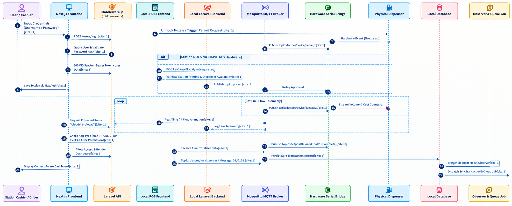

# Sales Transaction Workflow

## 1. Overview

The Sales Transaction Workflow describes the steps involved in processing a fuel sale in the Fuel Management System (FMS).

It illustrates the interaction between the user, frontend application, backend API, and database during a sales transaction.

## 2. Workflow Diagram

The following sequence diagram illustrates the interaction between the system components during a sales transaction.

**Figure 1: Sales Transaction Sequence Diagram**

## 3. Workflow Steps

* The user initiates a sales transaction through the frontend application.
* The frontend sends the transaction request to the backend API.
* The backend validates the request and interact with hardware device using Mqtt Client to control nozzle and 
   to get live data and performs the required business logic.
* The backend interacts with the database to process the transaction sync data to the cloud database using observer function. 
* The backend returns the transaction result to the frontend.
* The frontend displays the result to the user.

## 4. Expected Result

The transaction result is displayed to the user after the backend completes processing.