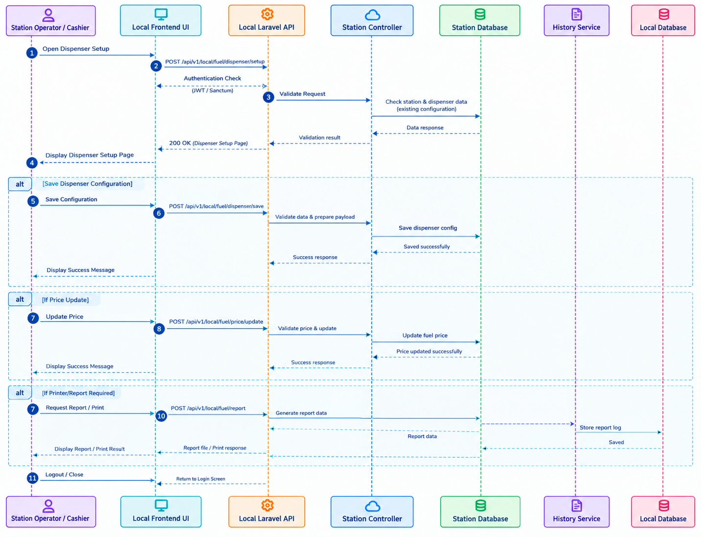

# Start and End Session Workflow

## 1. Overview

The Start and End Session Workflow describes how a station operator or cashier starts a station session and performs the end-of-day session closing process in the Fuel Management System (FMS).

The workflow illustrates the interaction between the Local Frontend, Local Laravel API, SessionController, SessionRepository, HistoryService, and Local Database.

It covers two main processes:

- **Start Session:** Validates the session request, checks the current session status, and records the session opening information.
- **End-of-Day Session:** Processes the session closing request, retrieves relevant sales and session data, and generates the end-of-day report.

## 2. Workflow Diagram

The following sequence diagram illustrates the interactions between the station operator, frontend, backend services, and local database during session initialization and end-of-day processing.

*Figure 1: Start and End Session Sequence Diagram*

## 3. Workflow Steps

### 3.1 Start Session

1. **Submit Start Session Request:** The station operator or cashier initiates a session through the Local Frontend.
2. **Send API Request:** The frontend sends a request to the Local Laravel API to start the session.
3. **Authenticate Request:** The backend authorizes the request using the configured Sanctum authentication mechanism.
4. **Check Session Status:** The SessionController and SessionRepository check the current session state and retrieve the relevant session data.
5. **Validate Active Session:** The system checks whether a session is already in progress.
6. **Handle Existing Session:** If an active session prevents a new session from starting, the API returns an error response and the frontend displays the appropriate message.
7. **Create Session Record:** If the request is valid, the system proceeds with session initialization and records the relevant session opening information in the Local Database.
8. **Process Opening Records:** The diagram shows the system processing the session's opening information and associated records.
9. **Return Response:** The backend returns the result of the session-start operation to the Local Frontend.
10. **Display Result:** The frontend displays the result to the station operator or cashier.

### 3.2 End-of-Day Session

1. **Submit End-of-Day Request:** The station operator or cashier initiates the end-of-day process through the Local Frontend.
2. **Send API Request:** The frontend submits a request to the Local Laravel API to end the session.
3. **Authenticate Request:** The backend authorizes the request using the configured Sanctum authentication mechanism.
4. **Retrieve Session Data:** The SessionController and SessionRepository retrieve the relevant session and sales information.
5. **Process Session Records:** The system processes the session information required for the closing operation.
6. **Retrieve Sales and Fuel Data:** The HistoryService retrieves relevant sales and fuel-related records for reporting.
7. **Generate End-of-Day Report:** The system processes the retrieved data and generates the applicable end-of-day sales report.
8. **Return Response:** The backend returns the result of the operation to the Local Frontend.
9. **Display Report:** The frontend displays the result to the station operator or cashier.

## 4. Technical Summary

| Component | Responsibility |
|---|---|
| **Station Operator / Cashier** | Initiates session start and end-of-day operations. |
| **Local Frontend** | Sends session requests and displays operation results. |
| **Local Laravel API** | Receives requests and coordinates session operations. |
| **SessionController** | Handles session-related API operations. |
| **SessionRepository** | Retrieves and manages session-related data through the application's data-access layer. |
| **HistoryService** | Retrieves historical sales and fuel-related information used in the reporting flow. |
| **Local Database** | Stores session records and related operational data. |

## 5. Expected Result

After a successful start-session operation, the system records the relevant session opening information and returns the result to the frontend.

During the end-of-day process, the system retrieves the required session and sales information, processes the relevant records, and returns the end-of-day report result to the frontend.

If a session cannot be started because an existing session is active, the system returns an error response as represented in the sequence diagram.

## 6. Related Documentation

- [System Architecture](../architecture.md)
- [API Documentation](../api.md)
- [Database Design](../database.md)
- [Authentication & Authorization](../authentication.md)
- [Sales Transaction Workflow](sales.md)
- [Credit Sale and Repayment Workflow](credit-sale.md)
- [Business Logic & Formulas](../formulas/daily-sales.md)
