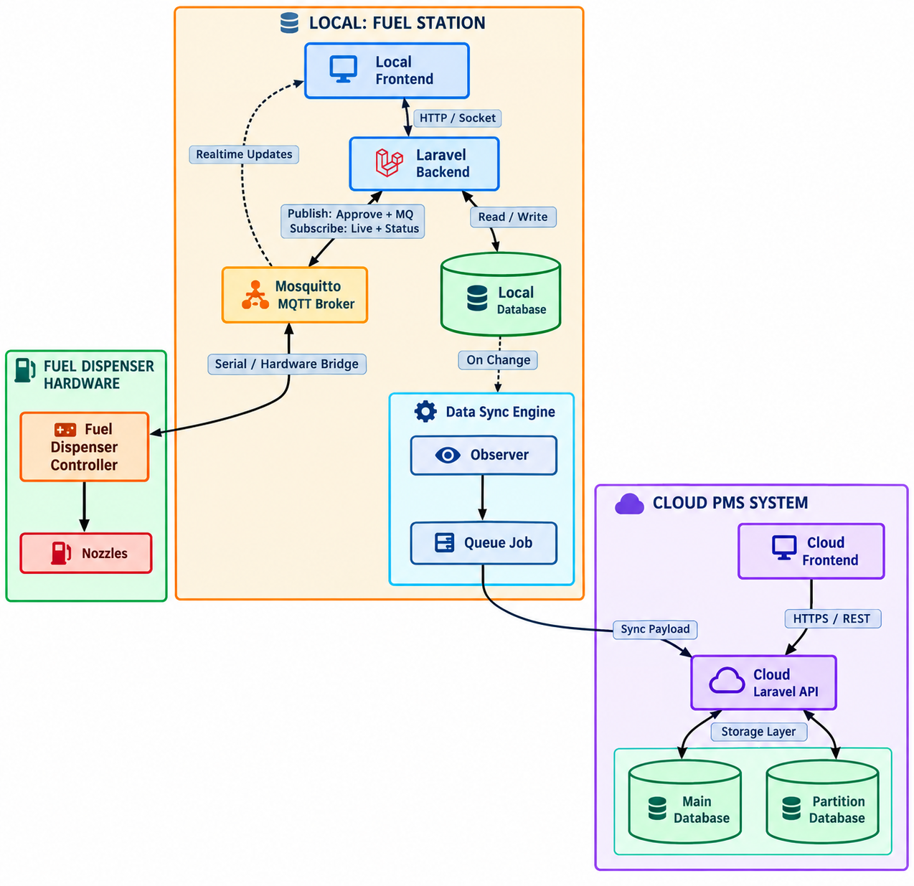

# System Architecture

## 1. Architecture Overview

FMS is organized as a web client, an API application, and supporting data and
integration services. The frontend and backend live in separate repositories.
The backend exposes local and cloud API route groups, while deployment
configuration determines which services and integrations are available.

###### Local mode: runs at a station and communicates with station equipment.

###### Cloud mode: provides centralized management and reporting across stations.

## 2. Core Architecture & System Data Flow

## 3. System Components

### 3.1 Frontend

**Responsibilities:**

- Display the user interface for local and cloud workflows.
- Handle user interactions and validate form input where implemented.
- Call the backend API using the configured API URL.
- Connect to the configured MQTT WebSocket endpoint for real-time features
  where enabled.

**Technology:** Next.js 15, React 19, TypeScript, and Axios.

### 3.2 Backend

**Responsibilities:**

- Process application requests and apply domain logic.
- Validate requests and return JSON responses.
- Authenticate API users and provide user, role, and permission management.
- Read and update application records in MySQL.
- Use Redis for configured cache and queue services.
- Integrate with MQTT and ATG services when enabled.

**Technology:** PHP 8.2+, Laravel 11, Laravel Sanctum, Laravel Horizon.

### 3.3 Database

**Responsibilities:**

- Store persistent application and operational data.
- Relate records such as stations, shops, tanks, dispensers, nozzles, sales,
  fuel deliveries, customers, and transaction histories.
- Apply schema constraints defined by database migrations.

**Technology:** MySQL in the documented Docker deployments. Laravel supports
database configuration through environment settings.

## 4. Module Architecture

| Module | Responsibility |
|---|---|
| Authentication and access control | Login, card-auth route, Sanctum-protected API access, user accounts, roles, and permissions. |
| Station setup | Manage stations, shops, and station-specific configuration. |
| Fuel and equipment | Manage tanks, fuel types, stock prices, dispensers, and nozzles. |
| Sales and daily operations | Manage sales, credit sales, station sales, price changes, and daily sessions. |
| Fuel delivery and history | Record fuel-ins, ATG-related data, histories, and history details. |
| Customer and business records | Cloud features for companies, customers, members, payments, discounts, vehicle types, and customer credits. |
| Dashboard and reporting | Present sales summaries and local/cloud operational reports. |
| Device integration | Exchange messages through MQTT and retrieve tank data through configured ATG services. |

## 5. Data Flow

1. A user performs an action in the Next.js frontend.
2. The frontend sends a JSON request to the configured Laravel API URL.
3. The backend authenticates protected routes and validates the request.
4. Application logic reads or updates MySQL records and uses Redis for
   configured cache or queue work.
5. For device or tank functions, backend or frontend components communicate
   with configured MQTT or ATG services as appropriate.
6. The backend returns a JSON response and the frontend displays the result.

## 6. API Communication

- **API style:** REST-like resource endpoints, including Laravel API resource
  routes, plus operation-specific endpoints.
- **Data format:** JSON.
- **Authentication method:** Laravel Sanctum protects local and cloud API
  route groups. Login and card-authentication endpoints are defined in the
  authentication routes. The frontend also uses NextAuth for its web session.
- **Error handling:** Shared backend response helpers return JSON with
  `message` and `data` fields and an HTTP status code. Laravel request
  validation and authentication failures use framework exception responses;
  exact error details can vary by endpoint and exception type.
- **Transport security:** The application URLs support HTTP or HTTPS based on
  deployment. Local station deployment documentation configures Caddy TLS;
  production TLS depends on the production host or proxy configuration.

## 7. Database Architecture

The schema is maintained through Laravel migrations. Main entity groups
include:

- **Station configuration:** stations, shops, tanks, fuel types, stock prices,
  dispensers, and nozzles.
- **Operations:** sales, station sales, fuel-ins, histories, history details,
  and daily session data.
- **Cloud business records:** companies, customers, members, payments,
  discounts, vehicle types, customer credits, and credit sales.
- **Access control:** users, personal access tokens, roles, and permissions.

Foreign keys and other constraints are defined in individual migration files.
The detailed table structure and relationships should be documented alongside
the database schema; this overview does not replace a database reference.

## 8. Security Architecture

- **Authentication:** Login, card-authentication, and logout routes are
  implemented. Sanctum middleware protects the local and cloud API groups.
- **Authorization:** The backend includes role and permission management.
  Seeded roles include `admin`, `installer`, `manager`, `cashier`, `pprd`, and
  `kyawsan`; permissions can be managed through the API.
- **Input validation:** Laravel request validation is used by authentication
  and application request flows. Frontend forms also use client-side
  validation in applicable screens.
- **Data protection:** Database, Redis, API, and integration credentials are
  supplied through environment configuration. Production deployments must
  protect these secrets and restrict service access.
- **Secure communication:** HTTPS/TLS is deployment-dependent. The local
  station setup documents Caddy internal TLS; production TLS must be provided
  by the configured host or reverse proxy.

## 9. Deployment Architecture

### Local station

The backend `docker-compose-local.yml` defines backend, MySQL, Redis, and
Mosquitto services. The frontend is a separate Next.js application configured
to use the local API and, where needed, MQTT WebSocket endpoint. The backend
repository's installer and networking setup can configure Caddy and station
services.

### Cloud / production

The backend `docker-compose-prod.yml` defines backend and Redis containers.
MySQL and MQTT are expected to be provided by separately configured services
or infrastructure. The frontend is deployed separately and points to the
configured cloud API URL.

### Runtime operations

Docker Compose and Supervisor run backend processes. The provided Supervisor
configurations start the Laravel application, Horizon, and scheduled or MQTT
processes according to local/production mode. The backend Makefile documents
health checks, logs, backups, and restore commands. Actual proxy, database
hosting, monitoring, and backup schedules depend on the deployment.

Environment variables configure application URLs, database credentials,
Redis, MQTT, and ATG endpoints. Each deployment must provide appropriate
production values.

## 10. Architecture Decisions

| Decision | Reason / trade-off |
|---|---|
| Separate frontend and backend repositories | Allows the Next.js interface and Laravel API to be developed and deployed independently; requires coordinated API URL and version configuration. |
| Local and cloud API route groups | Supports station-local workflows and centralized cloud workflows; available features differ between the groups. |
| MySQL for persistent data and Redis for cache/queues | Separates durable business records from cache and queue workloads; Redis availability is needed for configured background processing. |
| MQTT for device messaging | Supports station-device messaging and real-time frontend updates; requires broker access, credentials, and network configuration. |
| ATG accessed through a configurable endpoint | Allows tank data integration with a deployment-specific service; availability and data format depend on that service. |
| Docker Compose deployment configurations | Provides repeatable service setup for local and production modes; production database and MQTT services may be external. |

## 11. Related Documentation

- [Project Overview](index.md)
- [System Requirements](requirement.md)
- Backend setup and deployment: `fuel-management/README.md`
- Backend database migrations: `fuel-management/database/migrations/`
- Local networking: `fuel-management/NETWORK.md`
- MQTT notes: `fuel-management/MQTT.md`
- Frontend setup: `fuel-management-frontend-nextjs/README.md`
